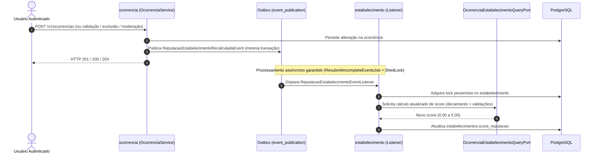
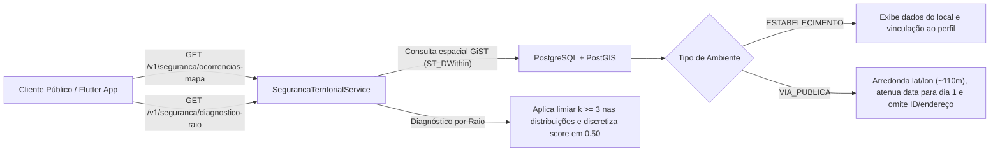

# Lume API

> **Inteligência territorial, reputação de estabelecimentos e segurança comunitária com privacidade *by-design*.**

[](https://github.com/luisfmaiadc/sboot-lume-monolith-api/actions/workflows/ci.yml)


O **Lume** é uma plataforma colaborativa de **segurança comunitária, preventiva e territorial**, concebida para empoderar pessoas — com foco especial em grupos historicamente vulnerabilizados (**mulheres, pessoas negras e comunidade LGBTQIA+**) — por meio de informações estruturadas, transparentes e anonimizadas sobre locais e áreas urbanas.

Operando no modelo **Search-First** (*"Para onde deseja ir?"*), a API atende a dois fluxos complementares:
- **Estabelecimentos (estilo *ReclameAqui*):** consulta de score de reputação (`0.00` a `5.00`), histórico de incidentes, distribuição por turno/tipo de violência e engajamento comunitário em bares, restaurantes, casas noturnas, instituições de ensino, shoppings e outros locais públicos ou comerciais.
- **Vias Públicas (Inteligência Territorial):** diagnóstico de risco em raio geográfico e visualização de ocorrências georreferenciadas em mapa, com atenuação espacial e temporal para proteção da vítima.

> [!NOTE]
> **Propósito e Escopo de Privacidade:** Este projeto possui caráter acadêmico/didático e impacto social, sem fins lucrativos. Em estrita conformidade com a **LGPD**, residências particulares estão fora do escopo da plataforma, relatos não possuem campo de texto livre e a identidade do autor nunca é exposta nas consultas públicas.

### 📚 Documentação Complementar
* **Regras de Negócio por Módulo:** [docs/regras-de-negocio.md](docs/regras-de-negocio.md) — detalhamento completo das regras (`RN`), fórmulas de reputação/risco, $k$-anonimidade, decisões de escopo e evoluções pós-MVP.
* **Modelagem de Dados PostgreSQL:** [docs/modelagem-dados.md](docs/modelagem-dados.md) — diagrama entidade-relacionamento (DER), dicionário de tabelas, tipos enumerados, índices `GIST`/compostos e infraestrutura Outbox/ShedLock.
* **Contrato OpenAPI 3.0.3:** [src/main/resources/api/openapi.yaml](src/main/resources/api/openapi.yaml) — especificação fonte da API (*Contract-First*).
* **Documento Dispositivos Móveis (Rony):** [docs/documentacao-projeto-dispositivos-moveis.md](docs/documentacao-projeto-dispositivos-moveis.md) — introdução, arquitetura Flutter, justificativa, diagramas e fluxo do usuário.
* **Collection Postman V1:** [postman/Lume_-_V1.postman_collection.json](postman/Lume_-_V1.postman_collection.json) — requisições HTTP apontando para o deploy no Render.
* **App Flutter (cliente):** repositório irmão `flutter-lume-app`.

---

## 🏛️ Visão Arquitetural: Monólito Modular

A aplicação adota o padrão de **Monólito Modular** guiado por **Domain-Driven Design (DDD)** com **Spring Modulith 2.1.1** (`@Modulithic`). Os contextos de negócio possuem fronteiras explicitamente isoladas e verificadas em tempo de teste pela suíte `ModulithStructureTest`:

```text
src/main/java/br/com/lume/api/
├── catalogo/         # Domínios públicos de apoio (violências, marcadores, categorias) + Cache Caffeine
├── identidade/       # Usuários, criptografia de CPF (HMAC + AES-GCM), autenticação JWT e lockout
├── estabelecimento/  # Cadastro, busca/autocomplete geoespacial, gestores e score de reputação
├── ocorrencia/       # Relatos estruturados, validações comunitárias, diagnóstico PostGIS e anonimização
└── shared/           # Segurança JWT/OAuth2, CORS, MDC (X-Request-Id), StandardError, portas, eventos e Outbox/ShedLock
```

### Princípios Técnicos Fundamentais
* **Contract-First (`OpenAPI 3.0.3`):** O contrato [openapi.yaml](src/main/resources/api/openapi.yaml) gera automaticamente interfaces Spring MVC (`br.com.lume.api.contract`) e DTOs de transporte (`br.com.lume.api.model`) durante o ciclo de build Maven.
* **Geolocalização Nativa (`PostGIS`):** Dados transacionais e espaciais unificados no PostgreSQL com tipo `GEOGRAPHY(Point, 4326)`, índices espaciais `GIST` e cálculos geodésicos via Hibernate Spatial (`ST_DWithin`, `ST_Distance`).
* **Comunicação Desacoplada e Transactional Outbox:** Módulos comunicam-se via fachadas internas (`*InternalFacade`), portas de consulta (`OcorrenciaEstabelecimentoQueryPort`) e eventos assíncronos persistidos na tabela `event_publication`, com reenvio automático resiliente via `ResubmitIncompleteEventsJob` coordenado por **ShedLock**.
* **Java 25 & Virtual Threads:** `spring.threads.virtual.enabled: true` habilitado nativamente, combinado com `spring.jpa.open-in-view: false` e validação estrita de schema via **Flyway** (`ddl-auto: validate`).
* **Observabilidade e Rastreabilidade:** `RequestIdFilter` propaga ou gera o cabeçalho `X-Request-Id` no MDC dos logs; o perfil `prod` ativa logs estruturados no formato **ECS**.

---

## 📦 Resumo Executivo dos Módulos

> Para regras detalhadas, fórmulas de cálculo, critérios de borda e catálogo completo de `RN`, consulte [docs/regras-de-negocio.md](docs/regras-de-negocio.md).

### 👤 1. Identidade e Acesso (`identidade`)
- **Proteção de CPF (LGPD):** Unicidade garantida por *Blind Index* determinístico (`HMAC-SHA256`) aliado à cifração reversível (`AES-256-GCM`) com IV aleatório por registro; o CPF nunca é gravado em logs ou exibido em respostas públicas.
- **Autenticação Stateless & Lockout:** Emissão de *access token* (máx. 15 minutos) e *refresh token* JWT (`HS256`), mitigação de *timing attacks* e bloqueio temporário por excesso de tentativas falhas (`HTTP 423`).
- **Controle de Papéis (RBAC):** Hierarquia `ROLE_ADMIN > ROLE_MODERADOR > ROLE_USUARIO`, além de `ROLE_GESTOR` para gerenciamento de estabelecimentos vinculados.

### 📚 2. Catálogos de Domínio (`catalogo`)
- Fornece os domínios estruturados que alimentam os formulários sem texto livre: **tipos de violência** (com peso de gravidade de `1` a `10`), **marcadores de vulnerabilidade** (misoginia, racismo, LGBTfobia, capacitismo, intolerância religiosa) e **categorias de estabelecimentos**.
- Servido com cache em memória via **Caffeine** (TTL de 1 hora, máximo de 500 entradas) e headers HTTP `Cache-Control: max-age=3600`.

### 🏢 3. Estabelecimentos (`estabelecimento`)
- **Descoberta *Search-First*:** Autocomplete rápido por prefixo e listagem paginada com filtros por categoria, município, bairro e proximidade geográfica (`ST_DWithin`).
- **Integridade e Gestão:** Validação de CNPJ alfanumérico e restrição de atualização cadastral/status operacional ao gestor oficial vinculado (`ROLE_GESTOR`).
- **Reputação Dinâmica:** Score inicial `5.00` (escala `0.00` a `5.00`) recalculado de forma assíncrona sempre que uma ocorrência vinculada é registrada, validada, moderada ou excluída.

### 📍 4. Ocorrências e Segurança Territorial (`ocorrencia`)
- **Relatos Estruturados:** Registro fechado sem texto livre (endereço canônico segmentado + turno + tipo de violência + marcador opcional) e limite anti-abuso de **5 ocorrências em 24h** por usuário (com lock transacional).
- **Ciclo de Vida e Endosso:** Exclusão lógica pelo autor em até 30 dias, moderação (`PUBLICADA`, `SOB_ANALISE`, `REMOVIDA`) e endosso comunitário (`PRESENCIEI`, `CONHECO_RISCO`) com trava anti-sybil e bloqueio de autovalidação.
- **Privacidade Geoespacial e $k$-Anonimidade:** Pontos públicos de via pública têm o `id` omitido no mapa, endereço suprimido no detalhe, coordenadas arredondadas para 3 casas decimais (`~110 m`) e datas atenuadas para o **1º dia do mês**. O diagnóstico por raio aplica decaimento temporal, discretização de risco em degraus de `0.50` e limiar $k \ge 3$ nas distribuições.

---

## 🧩 Fluxos Arquiteturais

### 1. Recálculo Assíncrono de Reputação (Transactional Outbox)



### 2. Consulta Territorial e Anonimização LGPD



---

## 🛠️ Stack Tecnológica

| Camada | Tecnologia | Versão / Detalhes |
| :--- | :--- | :--- |
| **Linguagem** | Java | **Java 25** (Virtual Threads + *Compact Object Headers*) |
| **Framework** | Spring Boot | **4.1.2** (Web MVC, Security, OAuth2 Resource Server, Validation, Cache) |
| **Arquitetura Modular** | Spring Modulith | **2.1.1** (Starter Core, Starter JPA Outbox, Docs) |
| **Persistência & Geo** | Spring Data JPA + Hibernate Spatial | `GEOGRAPHY(Point, 4326)` com índices `GIST` |
| **Banco de Dados** | PostgreSQL + PostGIS | Extensões `uuid-ossp` e `postgis` |
| **Migrations** | Flyway | Versionamento SQL (`V1__init_schema_and_domains.sql`) com `ddl-auto: validate` |
| **Cache em Memória** | Caffeine | Cache local dos catálogos públicos |
| **Agendamento** | ShedLock | **6.3.0** (`shedlock-provider-jdbc-template`) |
| **Contrato da API** | OpenAPI 3.0.3 | **OpenAPI Generator 7.26.0** (*Contract-First*) |
| **Produtividade** | MapStruct & Lombok | **MapStruct 1.6.3** + binding em tempo de compilação |
| **Testes** | JUnit 5 + Mockito + WebMVC Test | Testes unitários, `@WebMvcTest` (`SecurityFilterChain`) e `ModulithTest` |

---

## 📋 Catálogo Completo da API (`24 Operações`)

> Todas as respostas de erro seguem o contrato canônico `StandardError` (`timestamp`, `status`, `error`, `message`, `path`, `fields[]`) e incluem o cabeçalho de correlação `X-Request-Id`. Consulte os schemas completos de entrada e saída em [src/main/resources/api/openapi.yaml](src/main/resources/api/openapi.yaml).

### Autenticação (`/v1/auth`)
| Método | Endpoint | Acesso | Descrição |
| :--- | :--- | :--- | :--- |
| `POST` | `/v1/auth/cadastrar` | Público | Registra novo usuário com CPF cifrado e telefone normalizado (`201` + `Location`) |
| `POST` | `/v1/auth/login` | Público | Autentica credenciais com proteção de *lockout* (`423`) e retorna `accessToken` + `refreshToken` |
| `POST` | `/v1/auth/refresh` | Público | Emite novo par de tokens JWT a partir de um `refreshToken` válido |

### Usuários (`/v1/usuarios`)
| Método | Endpoint | Acesso | Descrição |
| :--- | :--- | :--- | :--- |
| `GET` | `/v1/usuarios/me` | Autenticado | Retorna os dados cadastrais do usuário autenticado |
| `PUT` | `/v1/usuarios/me` | Autenticado | Atualiza nome, telefone e dados demográficos opcionais do perfil logado |

### Catálogos (`/v1/catalogos`)
| Método | Endpoint | Acesso | Descrição |
| :--- | :--- | :--- | :--- |
| `GET` | `/v1/catalogos/tipos-violencia` | Público | Lista tipos de violência ativos com peso de gravidade (`1–10`) e ordem de exibição |
| `GET` | `/v1/catalogos/marcadores-vulnerabilidade` | Público | Lista marcadores de vulnerabilidade ativos (ex.: `MISOGINIA`, `RACISMO`, `LGBTFOBIA`) |
| `GET` | `/v1/catalogos/categorias-estabelecimentos` | Público | Lista categorias de estabelecimentos comerciais/públicos suportadas |

### Estabelecimentos (`/v1/estabelecimentos`)
| Método | Endpoint | Acesso | Descrição |
| :--- | :--- | :--- | :--- |
| `GET` | `/v1/estabelecimentos/autocomplete` | Público | Busca rápida por prefixo (`termo` ≥ 2 caracteres, `cidade`, `limite` 1–20) |
| `GET` | `/v1/estabelecimentos` | Público | Listagem paginada com filtros (`termo`, `categoriaId`, `cidade`, `bairro`) e busca por proximidade (`latitude`, `longitude`, `raioMetros` 100–5000) |
| `POST` | `/v1/estabelecimentos` | Autenticado | Cadastra novo estabelecimento com validação de CNPJ opcional e coordenadas (`201` + `Location`) |
| `GET` | `/v1/estabelecimentos/meu` | Autenticado (`ROLE_GESTOR`) | Retorna o estabelecimento ativo gerenciado pelo gestor logado (`204` se não houver vínculo) |
| `GET` | `/v1/estabelecimentos/{id}` | Público | Detalhe completo do estabelecimento: score (`0.00–5.00`), selo verificado e estatísticas agregadas |
| `PUT` | `/v1/estabelecimentos/{id}` | Autenticado (`ROLE_GESTOR`) | Atualiza dados cadastrais e status operacional do estabelecimento vinculado ao gestor |
| `GET` | `/v1/estabelecimentos/{id}/ocorrencias` | Público | Lista paginada de ocorrências vinculadas ao estabelecimento (contém `id` para endosso comunitário e omite autor) |

### Segurança Territorial (`/v1/seguranca`)
| Método | Endpoint | Acesso | Descrição |
| :--- | :--- | :--- | :--- |
| `GET` | `/v1/seguranca/diagnostico-raio` | Público | Calcula índice/nível de risco no perímetro (`raioMetros` 300–500m) com proteção $k \ge 3$ e decaimento temporal |
| `GET` | `/v1/seguranca/ocorrencias-mapa` | Público | Retorna pontos filtráveis (`dias` 1–365, violência, marcador, turno) para renderização no mapa (sem `id` e anonimizado em via pública) |

### Ocorrências e Validações (`/v1/ocorrencias`)
| Método | Endpoint | Acesso | Descrição |
| :--- | :--- | :--- | :--- |
| `POST` | `/v1/ocorrencias` | Autenticado | Registra ocorrência estruturada sem texto livre (máx. 5 relatos em 24h por usuário) (`201` + `Location`) |
| `GET` | `/v1/ocorrencias/minhas` | Autenticado | Lista paginada dos relatos criados pelo próprio usuário, indicando elegibilidade de exclusão (≤ 30 dias) |
| `GET` | `/v1/ocorrencias/{id}` | Público | Consulta detalhes de uma ocorrência publicada (omissão de autor; endereço e data atenuados em via pública) |
| `DELETE` | `/v1/ocorrencias/{id}` | Autenticado (Autor) | Exclui logicamente (`REMOVIDA`) a própria ocorrência publicada em até 30 dias |
| `PATCH` | `/v1/ocorrencias/{id}` | `ROLE_MODERADOR` / `ROLE_ADMIN` | Altera o status de moderação (`PUBLICADA`, `SOB_ANALISE`, `REMOVIDA`) |
| `POST` | `/v1/ocorrencias/{id}/validacoes` | Autenticado | Registra endosso comunitário (`PRESENCIEI` ou `CONHECO_RISCO`), bloqueando duplicidade e autovalidação (`201`) |
| `DELETE` | `/v1/ocorrencias/{id}/validacoes` | Autenticado | Cancela a validação comunitária previamente registrada pelo usuário (`204`) |

---

## 🌐 Ambiente de Demonstração (Render)

Uma instância didática da API está publicada no **Render (Free Tier)** para integração inicial e demonstrações:

- **Base URL:** `https://sboot-lume-monolith-api.onrender.com`

Exemplo rápido de verificação em rota pública:

```bash
curl -i https://sboot-lume-monolith-api.onrender.com/v1/catalogos/tipos-violencia
```

> [!IMPORTANT]
> **Limitações do Plano Gratuito do Render:**
> - **Hibernação (*Cold Start*):** o serviço entra em repouso após 15 minutos sem requisições; a primeira chamada após hibernar pode levar cerca de 30 a 60 segundos para responder.
> - **Banco Temporário:** instâncias PostgreSQL gratuitas no Render expiram após 30 dias — adequado apenas para fins didáticos e apresentações, não para produção definitiva.

---

## 🏁 Como Executar Localmente

### Pré-requisitos
* **Java JDK 25** configurado no `PATH` (validado pelo `maven-enforcer-plugin`)
* **Maven 3.9+** instalado
* **PostgreSQL 16+ com PostGIS** (via Docker ou instalação local com as extensões `postgis` e `uuid-ossp`)

### 1. Subir o PostgreSQL com PostGIS (Docker)

```bash
docker run -d \
  --name lume-postgis \
  -p 5432:5432 \
  -e POSTGRES_DB=lume_db \
  -e POSTGRES_USER=postgres \
  -e POSTGRES_PASSWORD=postgres \
  postgis/postgis:16-3.4
```

### 2. Compilar e Gerar Contratos OpenAPI
Gera as interfaces e modelos a partir de [openapi.yaml](src/main/resources/api/openapi.yaml) em `target/generated-sources/openapi`:

```bash
mvn clean compile
```

### 3. Executar a Aplicação
O perfil `local` ([application-local.yaml](src/main/resources/application-local.yaml)) já define datasource, chaves criptográficas e parâmetros JWT para desenvolvimento. Na inicialização, o **Flyway** aplica automaticamente a migration [V1__init_schema_and_domains.sql](src/main/resources/db/migration/V1__init_schema_and_domains.sql):

```bash
mvn spring-boot:run -Dspring-boot.run.profiles=local
```

A API estará acessível em `http://localhost:8080`.

---

## ⚙️ Variáveis de Ambiente e Execução com Docker

Fora do perfil `local`, todas as configurações sensíveis são injetadas por variáveis de ambiente conforme [application.yaml](src/main/resources/application.yaml).

### Variáveis de Ambiente Obrigatórias e Opcionais

| Variável | Obrigatória | Padrão / Formato | Restrições e Observações |
| :--- | :---: | :--- | :--- |
| `DB_URL` | Sim | `jdbc:postgresql://localhost:5432/lume_db` | Deve iniciar com o prefixo `jdbc:postgresql://` |
| `DB_USER` | Sim | — | Usuário do PostgreSQL |
| `DB_PASSWORD` | Sim | — | Senha do PostgreSQL |
| `DB_POOL_MAX` | Não | `10` | Em containers com pouca RAM (ex.: 512 MB), recomenda-se `5` |
| `DB_POOL_MIN_IDLE` | Não | `2` | Conexões mínimas ociosas no HikariCP |
| `JWT_SECRET` | Sim | — | Mínimo de **32 bytes** (256 bits) para `HS256` |
| `JWT_EXPIRATION_MS` | Sim | Ex.: `900000` | Valor em **milissegundos**; trava máxima de **`900000`** (15 min) em `JwtProperties` |
| `JWT_REFRESH_EXPIRATION_MS` | Sim | Ex.: `604800000` | Valor em **milissegundos** (ex.: 7 dias) |
| `JWT_ISSUER` | Não | `lume` | Validado no `JwtDecoder` |
| `CORS_ALLOWED_ORIGINS` | Sim | Ex.: `http://localhost:3000` | Origens permitidas separadas por vírgula (ou `*` apenas em demos) |
| `CPF_HMAC_KEY` | Sim | — | Mínimo de **32 bytes** (256 bits) para *Blind Index* `HMAC-SHA256` |
| `CPF_AES_KEY` | Sim | — | Deve possuir **exatamente 32 bytes** (256 bits) para `AES-256-GCM` |
| `SPRING_PROFILES_ACTIVE` | Não | — | Use `prod` em produção para habilitar logs estruturados **ECS** |
| `PORT` | Não | `8080` | Porta HTTP vinculada pelo `Dockerfile` (usada pelo Render) |

> [!IMPORTANT]
> **Atenção às travas de inicialização:** `JWT_EXPIRATION_MS` superior a `900000` ms ou `CPF_AES_KEY` diferente de exatos 32 bytes impedem a subida do contexto Spring (`@Validated` em `JwtProperties` e `CryptoProperties`).

### Build e Execução em Container ([Dockerfile](Dockerfile))
O `Dockerfile` utiliza **multi-stage build** (`maven:3.9-eclipse-temurin-25` → `eclipse-temurin:25-jre`), executa sob usuário não-root (`spring`) e aplica otimizações de memória para containers enxutos de 512 MB (`-XX:+UseSerialGC -XX:+UseCompactObjectHeaders -XX:MaxRAMPercentage=60.0 -Xss512k`):

```bash
docker build -t lume-api:latest .

docker run -d \
  --name lume-api \
  -p 8080:8080 \
  -e SPRING_PROFILES_ACTIVE=prod \
  -e DB_URL="jdbc:postgresql://host.docker.internal:5432/lume_db" \
  -e DB_USER="postgres" \
  -e DB_PASSWORD="postgres" \
  -e JWT_SECRET="sua-chave-secreta-jwt-com-pelo-menos-32-bytes" \
  -e JWT_EXPIRATION_MS=900000 \
  -e JWT_REFRESH_EXPIRATION_MS=604800000 \
  -e CORS_ALLOWED_ORIGINS="http://localhost:3000" \
  -e CPF_HMAC_KEY="sua-chave-hmac-cpf-com-pelo-menos-32-bytes" \
  -e CPF_AES_KEY="chave-aes-com-exatos-32-bytes-ok" \
  lume-api:latest
```

---

## 🧪 Testes e Qualidade

A suíte é **100% portável na JVM** utilizando o perfil autossuficiente [application-test.yaml](src/test/resources/application-test.yaml), sem exigir Docker ou banco externo para rodar:

```bash
mvn test
```

- **Cobertura atual:** **586 testes em 43 classes** (`0` falhas):
  - **Testes Unitários:** domínio rico, serviços, mappers MapStruct, criptografia (`CpfCryptoService`), geração/validação JWT (`JwtService`), cálculo de reputação/risco e validadores de CPF/CNPJ/Geo.
  - **Governança Modular (`ModulithStructureTest`):** valida o encapsulamento dos módulos Spring Modulith e gera diagramas arquiteturais em `target/spring-modulith-docs`.
  - **Integração Web & Segurança (`SecurityFilterChainWebMvcTest`):** 14 cenários `@WebMvcTest` cobrindo todos os 6 controllers contra a cadeia real de filtros (`SecurityConfig`, `JwtDecoder`, `RoleHierarchy`, `@PreAuthorize`, CORS, `X-Request-Id` e `GlobalExceptionHandler`).
- **Integração Contínua (GitHub Actions):** o pipeline [ci.yml](.github/workflows/ci.yml) automatiza compilação OpenAPI, suíte completa (`mvn -B test`), auditoria SCA (**Trivy**), empacotamento JAR e validação de build do `Dockerfile` a cada *push* ou *pull request* em `develop` e `main`.

> [!NOTE]
> Testes de integração ponta a ponta contra instância real de PostgreSQL + PostGIS + Flyway (via Testcontainers) estão mapeados como evolução natural para a etapa pós-MVP.

---

## 👨🏽‍💻 Autor

**Luis Felipe Maia da Costa**  
*Idealizador e Desenvolvedor Backend*

Entre em contato ou acompanhe a evolução do projeto:
* 💼 [LinkedIn](https://www.linkedin.com/in/luis-felipe-maia-da-costa/)
* 📧 [Email](mailto:lf.mcosta23@gmail.com)

---
*Tecnologia e privacidade a serviço da segurança comunitária.*
