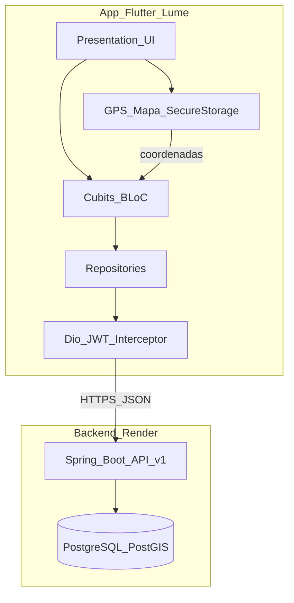
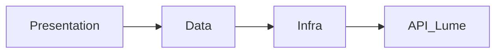
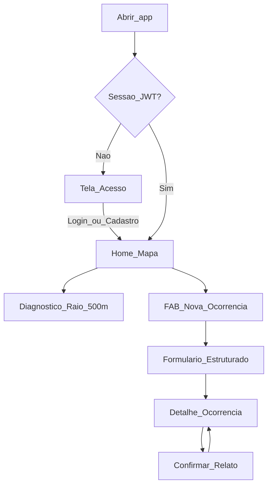

# Documento de Projeto de Software — Dispositivos Móveis

**Aplicativo:** Lume  
**Plataforma cliente:** Flutter (Android / iOS / Web)  
**API:** Spring Boot monolith (`sboot-lume-monolith-api`) — `https://sboot-lume-monolith-api.onrender.com`  
**Disciplina:** Projeto de Software para Dispositivos Móveis  

---

## 1. Introdução

### 1.1 Objetivo

O **Lume** é um aplicativo mobile de **segurança comunitária, preventiva e territorial**. Seu propósito é empoderar pessoas — com ênfase em grupos historicamente vulnerabilizados (mulheres, pessoas negras e comunidade LGBTQIA+) — a consultar o risco de uma região e registrar relatos estruturados e **anônimos** sobre ocorrências em vias públicas e estabelecimentos.

O app responde à pergunta *"Para onde desejo ir?"*: a pessoa abre o mapa, vê o **diagnóstico de raio** (ex.: 500 m) e, se autenticada, pode publicar um relato sem expor identidade.

Problema que resolve: a ausência de informação preventiva e comunitária, com privacidade *by-design* (LGPD), sobre a segurança de percursos urbanos cotidianos.

### 1.2 Público-alvo

- Cidadãos que circulam em centros urbanos e desejam avaliar o risco de um perímetro.
- Pessoas de grupos vulnerabilizados que buscam relatos contextuais (turno, tipo de violência, marcadores) sem se expor.
- Comunidade interessada em **validar** relatos de terceiros (“também presenciei” / “conheço o risco”).

### 1.3 Tecnologia escolhida

Foi escolhido o **Flutter** para o cliente mobile porque:

- permite um único código para Android, iOS e Web;
- possui ecossistema maduro para mapas (`flutter_map`) e GPS (`geolocator`);
- integra-se bem a APIs REST com JWT (`dio` + interceptor de refresh);
- favorece UI de alto contraste alinhada ao kit visual monochrome da marca Lume.

A API permanece em **Java / Spring Boot** (contrato OpenAPI 3.0.3), já implantada no Render.

---

## 2. Arquitetura do Software

### 2.1 Visão geral da arquitetura

O app Flutter adota organização em camadas:

| Camada | Responsabilidade |
|--------|------------------|
| **Presentation** | Telas (Acesso, Home, Nova Ocorrência, Detalhes), widgets do design system, Cubits/BLoC |
| **Domain/Data** | Models alinhados ao OpenAPI, repositórios |
| **Infra** | `Dio` (HTTP), `flutter_secure_storage` (JWT), `geolocator`, `flutter_map` |

A compatibilidade multiplataforma é garantida pelo próprio Flutter: a mesma árvore de widgets e a mesma camada de dados compilam para Android, iOS e Web, com plugins nativos apenas onde necessário (GPS/armazenamento seguro).

### 2.2 Componentes principais

#### Interface (UI)

- Widgets Material 3 customizados (tema monochrome preto/branco/cinza).
- Navegação declarativa com `go_router`.
- Formulários de autenticação e relato; mapa interativo; bottom sheets de diagnóstico e detalhe.
- Componentes reutilizáveis: logo sol/estrela, toggle Entrar/Cadastrar, pills de ambiente/turno.

#### Lógica de negócio

- `flutter_bloc` (`AuthCubit`, `HomeCubit`) para estado reativo.
- Repositórios encapsulam regras de chamada à API (login → persistir tokens; diagnóstico + mapa; registro/validação de ocorrência).
- Relatos **sem texto livre**: apenas catálogos fechados (`tipoViolencia`, `marcador`, `tipoAmbiente`, `faixaHorario`), alinhados à RN da API.

#### Acesso a recursos nativos

- **GPS** (`geolocator`) para centralizar o mapa e pré-preencher coordenadas do relato.
- **Mapa** (`flutter_map` + tiles OSM) para pins e raio de diagnóstico.
- **Armazenamento seguro** (`flutter_secure_storage`) para access/refresh JWT.

### 2.3 Tecnologias e ferramentas utilizadas

- Flutter 3.x / Dart 3
- `flutter_bloc`, `equatable`
- `dio`, `flutter_secure_storage`
- `go_router`
- `geolocator`, `flutter_map`, `latlong2`
- `google_fonts` (DM Sans)
- Backend: Spring Boot 4 + PostGIS + JWT (Render)

---

## 3. Justificativa para a Escolha da Tecnologia

### 3.1 Comparação

| Critério | Flutter | React Native | Nativo (Kotlin/Swift) |
|----------|---------|--------------|------------------------|
| Um codebase iOS/Android/Web | Forte | Bom (Web menos maduro) | Não |
| Performance de UI | Excelente (Skia/Impeller) | Boa | Excelente |
| Mapas + GPS | Pacotes estáveis | Depende de bridges | Nativo |
| Velocidade de entrega acadêmica | Alta | Alta | Menor (dois times) |
| Consistência visual com kit Lume | Alta (controle total de widgets) | Média | Alta, porém duplicada |

### 3.2 Considerações

Flutter foi preferido pela combinação de **produtividade**, **performance** e **controle visual** exigido pelo branding monochrome do Lume, sem abrir mão de recursos nativos (GPS/secure storage) necessários ao MVP territorial.

---

## 4. Diagrama de Arquitetura

Camadas no cliente:

---

## 5. Fluxo do Usuário

### 5.1 Passos principais

1. **Acesso** — usuário escolhe Entrar ou Cadastrar (nome, e-mail, telefone, CPF, senha). Dados sensíveis ficam na API; relatos públicos nunca expõem o autor.
2. **Home / Mapa** — GPS (ou fallback Av. Paulista) centraliza o mapa; app chama `diagnostico-raio` e `ocorrencias-mapa`; card inferior mostra nível de atenção, total de relatos e pico de turno.
3. **Nova ocorrência** — FAB “+”; usuário seleciona ambiente, período, tipo de violência e marcador opcional; publica relato anônimo estruturado.
4. **Detalhes** — visualiza ocorrência; pode **Confirmar este relato** (`POST /validacoes`).

### 5.2 Captura e apresentação de dados

- **Captura:** formulário de cadastro/login; GPS; seleção por pills/dropdowns (sem textarea livre).
- **Apresentação:** mapa com pins e círculo de raio; card de diagnóstico; card de detalhe com selo “Relato 100% Anônimo” e contagem de confirmações.

### 5.3 Fluxograma

### 5.4 Telas do kit visual (MVP)

1. Acesso (Entrar / Cadastrar)  
2. Home com mapa e diagnóstico  
3. Nova ocorrência  
4. Detalhes + confirmar  

---

## 6. Conclusão

### 6.1 Desafios e considerações

- **Cold start** do Render (free tier): primeira chamada pode levar 30–60s — timeouts do `dio` foram elevados e a UX comunica nova tentativa.
- **LGPD / anonimização:** o app não exibe autor; via pública omite endereço detalhado no detalhe público; formulário evita texto livre.
- **Geoespacial:** sincronizar centro do mapa, GPS e parâmetros de raio com a API PostGIS.
- **Auth JWT:** access curto + refresh transparente via interceptor.

### 6.2 Melhorias futuras

- Busca Search-First com autocomplete de estabelecimentos e página estilo “ReclameAqui da segurança”.
- Feed territorial com `id` para validação em vias públicas (hoje o mapa omite `id` por privacidade).
- Rate limiting no gateway e métricas.
- Deep links, push de alertas regionais e modo offline parcial de catálogos.

---

## Referências do projeto

- API: repositório `sboot-lume-monolith-api` — `docs/regras-de-negocio.md`, `src/main/resources/api/openapi.yaml`
- Collection: `postman/Lume_-_V1.postman_collection.json`
- App: repositório `flutter-lume-app`
