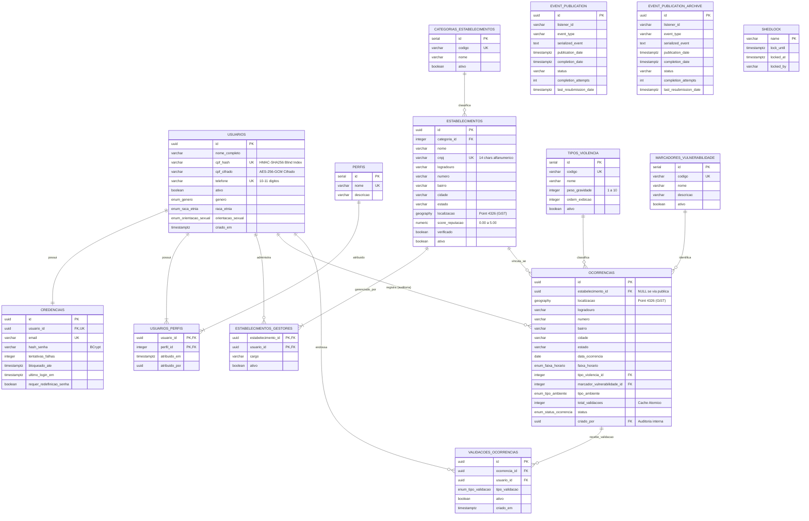

# Lume — Modelagem de Dados e Especificação PostgreSQL

> **SGBD:** PostgreSQL 16+ com extensão **PostGIS** (`uuid-ossp` e `postgis`)  
> **Versão do Schema:** `V1` Consolidada ([V1__init_schema_and_domains.sql](../src/main/resources/db/migration/V1__init_schema_and_domains.sql))  
> **Gerenciamento de Schema:** Flyway (`baseline-on-migrate: false`) + Hibernate (`ddl-auto: validate`)

> **Navegação:** [← Voltar ao README](../README.md) · [Regras de Negócio por Módulo](regras-de-negocio.md) · [Script DDL Flyway V1](../src/main/resources/db/migration/V1__init_schema_and_domains.sql)

---

## 1. Visão Geral da Arquitetura de Dados

A base de dados do **Lume** foi projetada para unificar dados transacionais, geoespaciais e infraestrutura assíncrona sob quatro princípios:

1. **Defesa em Profundidade e LGPD:** cifração em repouso de dados civis sensíveis (`cpf_cifrado` com AES-256-GCM e IV aleatório por linha) combinada com *Blind Index* (`cpf_hash` via HMAC-SHA256) para garantia de unicidade; isolamento entre dados pessoais (`usuarios`) e credenciais de acesso (`credenciais`); blindagem de `criado_por` nas leituras públicas.
2. **Eficiência Geoespacial Nativa:** uso do tipo `GEOGRAPHY(Point, 4326)` do PostGIS com índices espaciais **GiST**, permitindo consultas de raio em metros (`ST_DWithin`) e distância geodésica real (`ST_Distance`) diretamente no banco sem distorções cartográficas.
3. **Duplo Escopo sem Texto Livre:** suporte a ocorrências vinculadas a `estabelecimentos` (com score de reputação e gestores oficiais) ou ocorrências avulsas em espaços públicos urbanos (`estabelecimento_id IS NULL`), descartando residências particulares e campos narrativos abertos.
4. **Tipagem Estrita e Resiliência:** uso de tipos `ENUM` nativos do PostgreSQL mapeados via Hibernate (`@JdbcTypeCode(SqlTypes.NAMED_ENUM)`), além das tabelas de **Transactional Outbox** do Spring Modulith (`event_publication`) e lock distribuído (`shedlock`).

---

## 2. Diagrama Entidade-Relacionamento (ERD Consolidado)



---

## 3. Extensões e Tipos Enumerados (`ENUM`)

### Extensões Habilitadas
- **`uuid-ossp`**: geração padrão de chaves `UUID` (`uuid_generate_v4()`).
- **`postgis`**: suporte a `GEOGRAPHY(Point, 4326)`, índices espaciais `GIST` e funções `ST_DWithin`, `ST_Distance`, `ST_SetSRID` e `ST_MakePoint`.

### Tipos Enumerados Nativos

| Tipo PostgreSQL | Valores Permitidos | Módulo / Tabela |
| :--- | :--- | :--- |
| `enum_genero` | `MULHER_CIS`, `HOMEM_CIS`, `MULHER_TRANS`, `HOMEM_TRANS`, `NAO_BINARIO`, `OUTRO`, `PREFIRO_NAO_INFORMAR` | `identidade` (`usuarios`) |
| `enum_raca_etnia` | `BRANCA`, `PRETA`, `PARDA`, `INDIGENA`, `AMARELA`, `PREFIRO_NAO_INFORMAR` | `identidade` (`usuarios`) |
| `enum_orientacao_sexual` | `HETEROSSEXUAL`, `HOMOSSEXUAL`, `BISSEXUAL`, `PANSEXUAL`, `ASSEXUAL`, `OUTRO`, `PREFIRO_NAO_INFORMAR` | `identidade` (`usuarios`) |
| `enum_faixa_horario` | `MADRUGADA`, `MANHA`, `TARDE`, `NOITE` | `ocorrencia` (`ocorrencias`) |
| `enum_tipo_ambiente` | `ESTABELECIMENTO`, `VIA_PUBLICA`, `TRANSPORTE_PUBLICO`, `PARQUE_PRACA`, `OUTRO` | `ocorrencia` (`ocorrencias`) |
| `enum_status_ocorrencia` | `PUBLICADA`, `SOB_ANALISE`, `REMOVIDA` | `ocorrencia` (`ocorrencias`) |
| `enum_tipo_validacao` | `PRESENCIEI`, `CONHECO_RISCO` | `ocorrencia` (`validacoes_ocorrencias`) |

---

## 4. Especificação Detalhada das Tabelas por Módulo

### 4.1. Módulo: Identidade e Acesso (`identidade`)

#### Tabela: `usuarios`
* **Função no Negócio:** armazena os dados civis do usuário, chaves de anonimato/responsabilização do CPF e atributos demográficos opcionais.
* **Colunas:**
  * `id` (`UUID`, PK, `DEFAULT uuid_generate_v4()`): identificador universal (gerado na aplicação ou banco).
  * `nome_completo` (`VARCHAR(150)`, NOT NULL): nome completo do usuário.
  * `cpf_hash` (`VARCHAR(64)`, NOT NULL, UNIQUE): *Blind Index* determinístico gerado via HMAC-SHA256 (`lume.security.crypto.cpf-hmac-key`), garantindo unicidade sem exposição em texto plano.
  * `cpf_cifrado` (`VARCHAR(512)`, NOT NULL): cifra simétrica AES-256-GCM com IV aleatório por registro (`lume.security.crypto.cpf-aes-key`), manipulada via `CpfCryptoConverter`.
  * `telefone` (`VARCHAR(20)`, NOT NULL, UNIQUE): telefone normalizado apenas com dígitos (`CONSTRAINT chk_telefone_formato CHECK (telefone ~ '^[0-9]{10,11}$')`).
  * `ativo` (`BOOLEAN`, NOT NULL, `DEFAULT TRUE`): flag de habilitação da conta.
  * `genero` (`enum_genero`, NOT NULL, `DEFAULT 'PREFIRO_NAO_INFORMAR'`).
  * `raca_etnia` (`enum_raca_etnia`, NOT NULL, `DEFAULT 'PREFIRO_NAO_INFORMAR'`).
  * `orientacao_sexual` (`enum_orientacao_sexual`, NOT NULL, `DEFAULT 'PREFIRO_NAO_INFORMAR'`).
  * `criado_em` (`TIMESTAMPTZ`, NOT NULL), `criado_por` (`UUID`), `atualizado_em` (`TIMESTAMPTZ`), `atualizado_por` (`UUID`): auditoria via Spring Data JPA Auditing.

#### Tabela: `credenciais`
* **Função no Negócio:** isola dados de autenticação (e-mail/senha) e controla bloqueios temporários contra força bruta.
* **Colunas:**
  * `id` (`UUID`, PK).
  * `usuario_id` (`UUID`, NOT NULL, UNIQUE, FK → `usuarios.id` `ON DELETE CASCADE`): relação 1:1 com usuário.
  * `email` (`VARCHAR(255)`, NOT NULL, UNIQUE): e-mail normalizado em minúsculas.
  * `hash_senha` (`VARCHAR(255)`, NOT NULL): hash BCrypt da senha.
  * `tentativas_falhas` (`INTEGER`, NOT NULL, `DEFAULT 0`): contador de falhas consecutivas.
  * `bloqueado_ate` (`TIMESTAMPTZ`, NULL): timestamp UTC até o qual novas tentativas retornam `HTTP 423`.
  * `ultimo_login_em` (`TIMESTAMPTZ`, NULL): data/hora da última autenticação bem-sucedida.
  * `requer_redefinicao_senha` (`BOOLEAN`, NOT NULL, `DEFAULT FALSE`): flag preparada para fluxo de troca obrigatória.
  * `criado_em` (`TIMESTAMPTZ`, NOT NULL), `atualizado_em` (`TIMESTAMPTZ`).

#### Tabela: `perfis`
* **Função no Negócio:** domínio oficial dos papéis RBAC reconhecidos pelo Spring Security.
* **Colunas:** `id` (`SERIAL`, PK), `nome` (`VARCHAR(50)`, NOT NULL, UNIQUE), `descricao` (`VARCHAR(255)`).
* **Carga Inicial (`V1`):** `ROLE_USUARIO`, `ROLE_GESTOR`, `ROLE_MODERADOR`, `ROLE_ADMIN`.

#### Tabela: `usuarios_perfis`
* **Função no Negócio:** tabela associativa ($N:N$) entre usuários e perfis.
* **Colunas:** `usuario_id` (`UUID`, PK, FK → `usuarios.id` `ON DELETE CASCADE`), `perfil_id` (`INTEGER`, PK, FK → `perfis.id` `ON DELETE RESTRICT`), `atribuido_em` (`TIMESTAMPTZ`, NOT NULL), `atribuido_por` (`UUID`).

---

### 4.2. Módulo: Catálogos de Domínio (`catalogo`)

#### Tabela: `categorias_estabelecimentos`
* **Função no Negócio:** classifica os tipos de locais comerciais, educacionais, de saúde e lazer.
* **Colunas:** `id` (`SERIAL`, PK), `codigo` (`VARCHAR(50)`, NOT NULL, UNIQUE), `nome` (`VARCHAR(100)`, NOT NULL), `ativo` (`BOOLEAN`, NOT NULL, `DEFAULT TRUE`).
* **Carga Inicial (`V1`):** `BAR_RESTAURANTE`, `CASA_NOTURNA_SHOW`, `SHOPPING_COMERCIO`, `INSTITUICAO_ENSINO`, `ACADEMIA_ESPORTE`, `TRANSPORTE_TERMINAL`, `HOSPITAL_SAUDE`, `OUTRO`.

#### Tabela: `tipos_violencia`
* **Função no Negócio:** taxonomia estruturada de incidentes com peso de gravidade para o cálculo de reputação e risco.
* **Colunas:**
  * `id` (`SERIAL`, PK), `codigo` (`VARCHAR(50)`, NOT NULL, UNIQUE), `nome` (`VARCHAR(100)`, NOT NULL).
  * `peso_gravidade` (`INTEGER`, NOT NULL): validado por `CONSTRAINT chk_peso_gravidade CHECK (peso_gravidade BETWEEN 1 AND 10)`.
  * `ordem_exibicao` (`INTEGER`), `ativo` (`BOOLEAN`, NOT NULL, `DEFAULT TRUE`).
* **Carga Inicial (`V1`):** `ASSEDIO_VERBAL` (2), `IMPORTUNACAO_SEXUAL` (6), `PERSEGUICAO_STALKING` (5), `AGRESSAO_VERBAL_AMEACA` (4), `AGRESSAO_FISICA` (8), `ROUBO_FURTO` (6), `DISCRIMINACAO` (5), `ESTUPRO_VIOLENCIA_SEXUAL` (10), `LATROCINIO` (10), `HOMICIDIO_OU_TENTATIVA` (10), `OUTRO` (3).

#### Tabela: `marcadores_vulnerabilidade`
* **Função no Negócio:** classificação opcional da motivação discriminatória do incidente.
* **Colunas:** `id` (`SERIAL`, PK), `codigo` (`VARCHAR(50)`, NOT NULL, UNIQUE), `nome` (`VARCHAR(100)`, NOT NULL), `descricao` (`VARCHAR(255)`), `ativo` (`BOOLEAN`, NOT NULL, `DEFAULT TRUE`).
* **Carga Inicial (`V1`):** `MISOGINIA`, `RACISMO`, `LGBTFOBIA`, `CAPACITISMO`, `INTOLERANCIA_RELIGIOSA`.

---

### 4.3. Módulo: Estabelecimentos e Gestão (`estabelecimento`)

#### Tabela: `estabelecimentos`
* **Função no Negócio:** cadastro de estabelecimentos comerciais/públicos com localização espacial, endereço segmentado, selo de verificação e score de reputação.
* **Colunas:**
  * `id` (`UUID`, PK).
  * `categoria_id` (`INTEGER`, NOT NULL, FK → `categorias_estabelecimentos.id` `ON DELETE RESTRICT`).
  * `nome` (`VARCHAR(150)`, NOT NULL): nome comercial/fantasia.
  * `cnpj` (`VARCHAR(14)`, UNIQUE, NULL): CNPJ opcional de 14 caracteres (suporta o novo formato **alfanumérico** `^[0-9A-Za-z]{12}[0-9]{2}$`, normalizado em maiúsculas pelo domínio).
  * `logradouro` (`VARCHAR(150)`, NOT NULL), `numero` (`VARCHAR(20)`, NULL), `bairro` (`VARCHAR(100)`, NOT NULL), `cidade` (`VARCHAR(100)`, NOT NULL), `estado` (`VARCHAR(2)`, NOT NULL).
  * `localizacao` (`GEOGRAPHY(Point, 4326)`, NOT NULL): coordenadas WGS-84 com índice espacial `GIST`.
  * `score_reputacao` (`NUMERIC(3, 2)`, NOT NULL, `DEFAULT 5.00`): validado por `CONSTRAINT chk_score_range CHECK (score_reputacao BETWEEN 0.00 AND 5.00)`, atualizado assincronamente via eventos.
  * `verificado` (`BOOLEAN`, NOT NULL, `DEFAULT FALSE`): selo oficial de verificação.
  * `ativo` (`BOOLEAN`, NOT NULL, `DEFAULT TRUE`): flag operacional.
  * `criado_em`, `criado_por`, `atualizado_em`, `atualizado_por`: auditoria JPA.

#### Tabela: `estabelecimentos_gestores`
* **Função no Negócio:** controla o vínculo entre usuários (`ROLE_GESTOR`) e os estabelecimentos que estão autorizados a gerenciar.
* **Colunas:**
  * `estabelecimento_id` (`UUID`, PK, FK → `estabelecimentos.id` `ON DELETE CASCADE`).
  * `usuario_id` (`UUID`, PK, FK → `usuarios.id` `ON DELETE CASCADE`).
  * `cargo` (`VARCHAR(50)`, NOT NULL): vínculo funcional (ex.: `GESTOR_RESPONSAVEL`).
  * `ativo` (`BOOLEAN`, NOT NULL, `DEFAULT TRUE`).
  * `vinculado_em` (`TIMESTAMPTZ`, NOT NULL), `vinculado_por` (`UUID`).

---

### 4.4. Módulo: Ocorrências e Inteligência Coletiva (`ocorrencia`)

#### Tabela: `ocorrencias`
* **Função no Negócio:** armazena os relatos estruturados de segurança associados a estabelecimentos ou espaços públicos urbanos.
* **Colunas:**
  * `id` (`UUID`, PK).
  * `estabelecimento_id` (`UUID`, NULL, FK → `estabelecimentos.id` `ON DELETE SET NULL`): preenchido quando `tipo_ambiente = 'ESTABELECIMENTO'`; `NULL` em vias e espaços públicos.
  * `localizacao` (`GEOGRAPHY(Point, 4326)`, NOT NULL): coordenada armazenada em precisão real com índice `GIST` (atenuada em ~110 m no mapeamento de resposta pública quando `estabelecimento_id IS NULL`).
  * `logradouro` (`VARCHAR(150)`, NOT NULL), `numero` (`VARCHAR(20)`, NULL), `bairro` (`VARCHAR(100)`, NOT NULL), `cidade` (`VARCHAR(100)`, NOT NULL), `estado` (`VARCHAR(2)`, NOT NULL).
  * `data_ocorrencia` (`DATE`, NOT NULL): data do fato (base para o decaimento temporal).
  * `faixa_horario` (`enum_faixa_horario`, NOT NULL): turno (`MADRUGADA`, `MANHA`, `TARDE`, `NOITE`).
  * `tipo_violencia_id` (`INTEGER`, NOT NULL, FK → `tipos_violencia.id` `ON DELETE RESTRICT`).
  * `marcador_vulnerabilidade_id` (`INTEGER`, NULL, FK → `marcadores_vulnerabilidade.id` `ON DELETE RESTRICT`).
  * `tipo_ambiente` (`enum_tipo_ambiente`, NOT NULL).
  * `total_validacoes` (`INTEGER`, NOT NULL, `DEFAULT 0`): contador mantido atomicamente por queries `@Modifying` no repositório.
  * `status` (`enum_status_ocorrencia`, NOT NULL, `DEFAULT 'PUBLICADA'`).
  * `criado_em` (`TIMESTAMPTZ`, NOT NULL), `criado_por` (`UUID`, NOT NULL, FK → `usuarios.id` `ON DELETE RESTRICT`), `atualizado_em` (`TIMESTAMPTZ`), `atualizado_por` (`UUID`, NULL, FK → `usuarios.id` `ON DELETE SET NULL`).

#### Tabela: `validacoes_ocorrencias`
* **Função no Negócio:** registra o endosso comunitário de terceiros sobre uma ocorrência publicada.
* **Colunas:**
  * `id` (`UUID`, PK).
  * `ocorrencia_id` (`UUID`, NOT NULL, FK → `ocorrencias.id` `ON DELETE CASCADE`).
  * `usuario_id` (`UUID`, NOT NULL, FK → `usuarios.id` `ON DELETE CASCADE`).
  * `tipo_validacao` (`enum_tipo_validacao`, NOT NULL): `PRESENCIEI` ou `CONHECO_RISCO`.
  * `ativo` (`BOOLEAN`, NOT NULL, `DEFAULT TRUE`): permite cancelamento lógico e reativação preservando a constraint única.
  * `criado_em`, `criado_por`, `atualizado_em` (`TIMESTAMPTZ`), `atualizado_por` (`UUID`, NULL, FK → `usuarios.id` `ON DELETE SET NULL`).
* **Restrições:** `CONSTRAINT uk_ocorrencia_usuario UNIQUE (ocorrencia_id, usuario_id)` impede múltiplos votos do mesmo usuário na mesma ocorrência. A regra anti-autovalidação é garantida na camada de domínio (`ValidacaoOcorrencia.criar`).

---

### 4.5. Infraestrutura Transversal (`shared`: Spring Modulith Outbox & ShedLock)

#### Tabelas: `event_publication` e `event_publication_archive`
* Gerenciadas pelo `spring-modulith-starter-jpa` (`spring.modulith.events.completion-mode: delete` e `schema-initialization.enabled: false` em `application.yaml`, pois o DDL é provisionado via Flyway).
* Garantem que o evento `ReputacaoEstabelecimentoRecalculadaEvent` seja persistido na mesma transação ACID da alteração da ocorrência e entregue com garantia *at-least-once*.

#### Tabela: `shedlock`
* Gerenciada pelo `shedlock-provider-jdbc-template` para coordenar a execução exclusiva do job `ResubmitIncompleteEventsJob` entre múltiplas instâncias da API (`name`, `lock_until`, `locked_at`, `locked_by`).

---

## 5. Estratégia de Índices e Integridade

### Índices Criados na Migration `V1`

| Índice | Tabela | Tipo / Colunas | Finalidade Principal |
| :--- | :--- | :--- | :--- |
| `idx_ocorrencias_localizacao_gist` | `ocorrencias` | `GIST (localizacao)` | Consultas `ST_DWithin` no mapa e diagnóstico por raio |
| `idx_estabelecimentos_localizacao_gist` | `estabelecimentos` | `GIST (localizacao)` | Busca e ordenação espacial (`ST_DWithin`, `ST_Distance`) |
| `idx_usuarios_cpf_hash` | `usuarios` | `B-Tree (cpf_hash)` | Verificação rápida de duplicidade por *Blind Index* |
| `idx_usuarios_telefone` | `usuarios` | `B-Tree (telefone)` | Checagem de unicidade de telefone no cadastro/edição |
| `idx_credenciais_email` | `credenciais` | `B-Tree (email)` | Localização de credencial no login |
| `idx_estabelecimentos_bairro_cidade` | `estabelecimentos` | `B-Tree (bairro, cidade)` | Filtros territoriais textuais de estabelecimentos |
| `idx_ocorrencias_bairro_cidade` | `ocorrencias` | `B-Tree (bairro, cidade)` | Filtros e agrupamentos por bairro/cidade |
| `idx_ocorrencias_estabelecimento_id` | `ocorrencias` | `B-Tree (estabelecimento_id)` | Histórico e estatísticas por estabelecimento |
| `idx_ocorrencias_status_data` | `ocorrencias` | `B-Tree (status, data_ocorrencia DESC)` | Janela retroativa de publicadas e ordenação cronológica |
| `idx_ocorrencias_status_faixa_data` | `ocorrencias` | `B-Tree (status, faixa_horario, data_ocorrencia DESC)` | Filtros combinados por turno no mapa e diagnósticos |
| `idx_ocorrencias_tipo_violencia` | `ocorrencias` | `B-Tree (tipo_violencia_id)` | Filtros e joins por tipo de violência |
| `idx_ocorrencias_marcador` | `ocorrencias` | `B-Tree (marcador_vulnerabilidade_id)` | Filtros por marcador de vulnerabilidade |
| `idx_validacoes_ocorrencia_ativo` | `validacoes_ocorrencias` | `B-Tree (ocorrencia_id, usuario_id, ativo)` | Verificação de voto ativo e cancelamento |
| `idx_event_publication_serialized_event` | `event_publication` | `B-Tree (listener_id, serialized_event)` | Localização de publicações por listener/payload no Modulith |
| `idx_event_publication_by_completion_date` | `event_publication` | `B-Tree (completion_date)` | Varredura de eventos pendentes pelo `ResubmitIncompleteEventsJob` |
| `idx_event_publication_archive_by_completion_date` | `event_publication_archive` | `B-Tree (completion_date)` | Manutenção e consulta de eventos arquivados |

---

## 6. Script DDL Consolidado (Flyway `V1__init_schema_and_domains.sql`)

Fonte oficial executada pelo Flyway na inicialização: [src/main/resources/db/migration/V1__init_schema_and_domains.sql](../src/main/resources/db/migration/V1__init_schema_and_domains.sql).

```sql
-- ============================================================================
-- PROJETO Lume — SCRIPT DDL CONSOLIDADO V1 (PostgreSQL 16+ com PostGIS)
-- ============================================================================

-- 1. EXTENSÕES
CREATE EXTENSION IF NOT EXISTS "uuid-ossp";
CREATE EXTENSION IF NOT EXISTS "postgis";

-- 2. TIPOS ENUMERADOS (Fluxos e Estados Técnicos)
CREATE TYPE enum_genero AS ENUM (
    'MULHER_CIS', 'HOMEM_CIS', 'MULHER_TRANS', 'HOMEM_TRANS',
    'NAO_BINARIO', 'OUTRO', 'PREFIRO_NAO_INFORMAR'
);

CREATE TYPE enum_raca_etnia AS ENUM (
    'BRANCA', 'PRETA', 'PARDA', 'INDIGENA', 'AMARELA', 'PREFIRO_NAO_INFORMAR'
);

CREATE TYPE enum_orientacao_sexual AS ENUM (
    'HETEROSSEXUAL', 'HOMOSSEXUAL', 'BISSEXUAL', 'PANSEXUAL', 'ASSEXUAL', 'OUTRO', 'PREFIRO_NAO_INFORMAR'
);

CREATE TYPE enum_faixa_horario AS ENUM (
    'MADRUGADA', 'MANHA', 'TARDE', 'NOITE'
);

CREATE TYPE enum_tipo_ambiente AS ENUM (
    'ESTABELECIMENTO', 'VIA_PUBLICA', 'TRANSPORTE_PUBLICO', 'PARQUE_PRACA', 'OUTRO'
);

CREATE TYPE enum_status_ocorrencia AS ENUM (
    'PUBLICADA', 'SOB_ANALISE', 'REMOVIDA'
);

CREATE TYPE enum_tipo_validacao AS ENUM (
    'PRESENCIEI', 'CONHECO_RISCO'
);

-- 3. TABELAS: IDENTIDADE E ACESSO

CREATE TABLE usuarios (
    id UUID PRIMARY KEY DEFAULT uuid_generate_v4(),
    nome_completo VARCHAR(150) NOT NULL,
    cpf_hash VARCHAR(64) NOT NULL UNIQUE,
    cpf_cifrado VARCHAR(512) NOT NULL,
    telefone VARCHAR(20) NOT NULL UNIQUE,
    ativo BOOLEAN NOT NULL DEFAULT TRUE,
    genero enum_genero NOT NULL DEFAULT 'PREFIRO_NAO_INFORMAR',
    raca_etnia enum_raca_etnia NOT NULL DEFAULT 'PREFIRO_NAO_INFORMAR',
    orientacao_sexual enum_orientacao_sexual NOT NULL DEFAULT 'PREFIRO_NAO_INFORMAR',
    criado_em TIMESTAMPTZ NOT NULL DEFAULT CURRENT_TIMESTAMP,
    criado_por UUID,
    atualizado_em TIMESTAMPTZ,
    atualizado_por UUID,
    CONSTRAINT chk_telefone_formato CHECK (telefone ~ '^[0-9]{10,11}$')
);

CREATE TABLE credenciais (
    id UUID PRIMARY KEY DEFAULT uuid_generate_v4(),
    usuario_id UUID NOT NULL UNIQUE,
    email VARCHAR(255) NOT NULL UNIQUE,
    hash_senha VARCHAR(255) NOT NULL,
    tentativas_falhas INTEGER NOT NULL DEFAULT 0,
    bloqueado_ate TIMESTAMPTZ,
    ultimo_login_em TIMESTAMPTZ,
    requer_redefinicao_senha BOOLEAN NOT NULL DEFAULT FALSE,
    criado_em TIMESTAMPTZ NOT NULL DEFAULT CURRENT_TIMESTAMP,
    atualizado_em TIMESTAMPTZ,
    CONSTRAINT fk_credenciais_usuario FOREIGN KEY (usuario_id) 
        REFERENCES usuarios(id) ON DELETE CASCADE
);

CREATE TABLE perfis (
    id SERIAL PRIMARY KEY,
    nome VARCHAR(50) NOT NULL UNIQUE,
    descricao VARCHAR(255)
);

INSERT INTO perfis (nome, descricao) VALUES
    ('ROLE_USUARIO', 'Acesso de usuário comum'),
    ('ROLE_GESTOR', 'Gestor autorizado de estabelecimento comercial'),
    ('ROLE_MODERADOR', 'Moderação de conteúdo e denúncias'),
    ('ROLE_ADMIN', 'Administrador completo da plataforma');

CREATE TABLE usuarios_perfis (
    usuario_id UUID NOT NULL,
    perfil_id INTEGER NOT NULL,
    atribuido_em TIMESTAMPTZ NOT NULL DEFAULT CURRENT_TIMESTAMP,
    atribuido_por UUID,
    PRIMARY KEY (usuario_id, perfil_id),
    CONSTRAINT fk_usuarios_perfis_usuario FOREIGN KEY (usuario_id) 
        REFERENCES usuarios(id) ON DELETE CASCADE,
    CONSTRAINT fk_usuarios_perfis_perfil FOREIGN KEY (perfil_id) 
        REFERENCES perfis(id) ON DELETE RESTRICT
);

-- 4. TABELAS: DOMÍNIOS DE CONFIGURAÇÃO

CREATE TABLE categorias_estabelecimentos (
    id SERIAL PRIMARY KEY,
    codigo VARCHAR(50) NOT NULL UNIQUE,
    nome VARCHAR(100) NOT NULL,
    ativo BOOLEAN NOT NULL DEFAULT TRUE
);

INSERT INTO categorias_estabelecimentos (codigo, nome) VALUES
    ('BAR_RESTAURANTE', 'Bares e Restaurantes'),
    ('CASA_NOTURNA_SHOW', 'Casas Noturnas e Shows'),
    ('SHOPPING_COMERCIO', 'Shoppings e Centros Comerciais'),
    ('INSTITUICAO_ENSINO', 'Faculdades e Escolas'),
    ('ACADEMIA_ESPORTE', 'Academias e Clubes'),
    ('TRANSPORTE_TERMINAL', 'Estações e Terminais'),
    ('HOSPITAL_SAUDE', 'Hospitais e Unidades de Saúde'),
    ('OUTRO', 'Outros Estabelecimentos');

CREATE TABLE tipos_violencia (
    id SERIAL PRIMARY KEY,
    codigo VARCHAR(50) NOT NULL UNIQUE,
    nome VARCHAR(100) NOT NULL,
    peso_gravidade INTEGER NOT NULL,
    ordem_exibicao INTEGER,
    ativo BOOLEAN NOT NULL DEFAULT TRUE,
    CONSTRAINT chk_peso_gravidade CHECK (peso_gravidade BETWEEN 1 AND 10)
);

INSERT INTO tipos_violencia (codigo, nome, peso_gravidade, ordem_exibicao) VALUES
    ('ASSEDIO_VERBAL', 'Assédio Verbal / Importunação', 2, 1),
    ('IMPORTUNACAO_SEXUAL', 'Importunação Sexual', 6, 2),
    ('PERSEGUICAO_STALKING', 'Perseguição (Stalking)', 5, 3),
    ('AGRESSAO_VERBAL_AMEACA', 'Ameaça e Intimidação Verbal', 4, 4),
    ('AGRESSAO_FISICA', 'Agressão Física', 8, 5),
    ('ROUBO_FURTO', 'Roubo / Furto', 6, 6),
    ('DISCRIMINACAO', 'Discriminação / Preconceito', 5, 7),
    ('ESTUPRO_VIOLENCIA_SEXUAL', 'Estupro / Violência Sexual', 10, 8),
    ('LATROCINIO', 'Latrocínio (Roubo seguido de Morte)', 10, 9),
    ('HOMICIDIO_OU_TENTATIVA', 'Homicídio ou Tentativa', 10, 10),
    ('OUTRO', 'Outro Tipo de Violência', 3, 11);

CREATE TABLE marcadores_vulnerabilidade (
    id SERIAL PRIMARY KEY,
    codigo VARCHAR(50) NOT NULL UNIQUE,
    nome VARCHAR(100) NOT NULL,
    descricao VARCHAR(255),
    ativo BOOLEAN NOT NULL DEFAULT TRUE
);

INSERT INTO marcadores_vulnerabilidade (codigo, nome, descricao) VALUES
    ('MISOGINIA', 'Violência contra a Mulher / Misoginia', 'Ataque motivado pelo fato de a vítima ser mulher.'),
    ('RACISMO', 'Racismo / Injúria Racial', 'Agressão motivada por cor, raça ou etnia.'),
    ('LGBTFOBIA', 'LGBTfobia / Homofobia / Transfobia', 'Violência motivada pela orientação sexual ou identidade de gênero.'),
    ('CAPACITISMO', 'Capacitismo', 'Discriminação contra pessoas com deficiência.'),
    ('INTOLERANCIA_RELIGIOSA', 'Intolerância Religiosa', 'Ataque motivado por crença ou manifestação religiosa.');

-- 5. TABELAS: ESTABELECIMENTOS E GESTÃO

CREATE TABLE estabelecimentos (
    id UUID PRIMARY KEY DEFAULT uuid_generate_v4(),
    categoria_id INTEGER NOT NULL,
    nome VARCHAR(150) NOT NULL,
    cnpj VARCHAR(14) UNIQUE,
    logradouro VARCHAR(150) NOT NULL,
    numero VARCHAR(20),
    bairro VARCHAR(100) NOT NULL,
    cidade VARCHAR(100) NOT NULL,
    estado VARCHAR(2) NOT NULL,
    localizacao GEOGRAPHY(Point, 4326) NOT NULL,
    score_reputacao NUMERIC(3, 2) NOT NULL DEFAULT 5.00,
    verificado BOOLEAN NOT NULL DEFAULT FALSE,
    ativo BOOLEAN NOT NULL DEFAULT TRUE,
    criado_em TIMESTAMPTZ NOT NULL DEFAULT CURRENT_TIMESTAMP,
    criado_por UUID,
    atualizado_em TIMESTAMPTZ,
    atualizado_por UUID,
    CONSTRAINT fk_estabelecimentos_categoria FOREIGN KEY (categoria_id) 
        REFERENCES categorias_estabelecimentos(id) ON DELETE RESTRICT,
    CONSTRAINT chk_score_range CHECK (score_reputacao BETWEEN 0.00 AND 5.00)
);

CREATE TABLE estabelecimentos_gestores (
    estabelecimento_id UUID NOT NULL,
    usuario_id UUID NOT NULL,
    cargo VARCHAR(50) NOT NULL,
    ativo BOOLEAN NOT NULL DEFAULT TRUE,
    vinculado_em TIMESTAMPTZ NOT NULL DEFAULT CURRENT_TIMESTAMP,
    vinculado_por UUID,
    PRIMARY KEY (estabelecimento_id, usuario_id),
    CONSTRAINT fk_gestores_estabelecimento FOREIGN KEY (estabelecimento_id) 
        REFERENCES estabelecimentos(id) ON DELETE CASCADE,
    CONSTRAINT fk_gestores_usuario FOREIGN KEY (usuario_id) 
        REFERENCES usuarios(id) ON DELETE CASCADE
);

-- 6. TABELAS: OCORRÊNCIAS E VALIDAÇÕES

CREATE TABLE ocorrencias (
    id UUID PRIMARY KEY DEFAULT uuid_generate_v4(),
    estabelecimento_id UUID,
    localizacao GEOGRAPHY(Point, 4326) NOT NULL,
    logradouro VARCHAR(150) NOT NULL,
    numero VARCHAR(20),
    bairro VARCHAR(100) NOT NULL,
    cidade VARCHAR(100) NOT NULL,
    estado VARCHAR(2) NOT NULL,
    data_ocorrencia DATE NOT NULL,
    faixa_horario enum_faixa_horario NOT NULL,
    tipo_violencia_id INTEGER NOT NULL,
    marcador_vulnerabilidade_id INTEGER,
    tipo_ambiente enum_tipo_ambiente NOT NULL,
    total_validacoes INTEGER NOT NULL DEFAULT 0,
    status enum_status_ocorrencia NOT NULL DEFAULT 'PUBLICADA',
    criado_em TIMESTAMPTZ NOT NULL DEFAULT CURRENT_TIMESTAMP,
    criado_por UUID NOT NULL,
    atualizado_em TIMESTAMPTZ,
    atualizado_por UUID,
    CONSTRAINT fk_ocorrencias_estabelecimento FOREIGN KEY (estabelecimento_id) 
        REFERENCES estabelecimentos(id) ON DELETE SET NULL,
    CONSTRAINT fk_ocorrencias_tipo_violencia FOREIGN KEY (tipo_violencia_id) 
        REFERENCES tipos_violencia(id) ON DELETE RESTRICT,
    CONSTRAINT fk_ocorrencias_marcador FOREIGN KEY (marcador_vulnerabilidade_id) 
        REFERENCES marcadores_vulnerabilidade(id) ON DELETE RESTRICT,
    CONSTRAINT fk_ocorrencias_criador FOREIGN KEY (criado_por) 
        REFERENCES usuarios(id) ON DELETE RESTRICT,
    CONSTRAINT fk_ocorrencias_atualizador FOREIGN KEY (atualizado_por) 
        REFERENCES usuarios(id) ON DELETE SET NULL
);

CREATE TABLE validacoes_ocorrencias (
    id UUID PRIMARY KEY DEFAULT uuid_generate_v4(),
    ocorrencia_id UUID NOT NULL,
    usuario_id UUID NOT NULL,
    tipo_validacao enum_tipo_validacao NOT NULL,
    ativo BOOLEAN NOT NULL DEFAULT TRUE,
    criado_em TIMESTAMPTZ NOT NULL DEFAULT CURRENT_TIMESTAMP,
    criado_por UUID NOT NULL,
    atualizado_em TIMESTAMPTZ,
    atualizado_por UUID,
    CONSTRAINT uk_ocorrencia_usuario UNIQUE (ocorrencia_id, usuario_id),
    CONSTRAINT fk_validacoes_ocorrencia FOREIGN KEY (ocorrencia_id) 
        REFERENCES ocorrencias(id) ON DELETE CASCADE,
    CONSTRAINT fk_validacoes_usuario FOREIGN KEY (usuario_id) 
        REFERENCES usuarios(id) ON DELETE CASCADE,
    CONSTRAINT fk_validacoes_atualizador FOREIGN KEY (atualizado_por) 
        REFERENCES usuarios(id) ON DELETE SET NULL
);

-- 7. ÍNDICES DE PERFORMANCE E ESPACIAIS

CREATE INDEX idx_ocorrencias_localizacao_gist ON ocorrencias USING GIST (localizacao);
CREATE INDEX idx_estabelecimentos_localizacao_gist ON estabelecimentos USING GIST (localizacao);

CREATE INDEX idx_usuarios_cpf_hash ON usuarios(cpf_hash);
CREATE INDEX idx_usuarios_telefone ON usuarios(telefone);
CREATE INDEX idx_credenciais_email ON credenciais(email);
CREATE INDEX idx_estabelecimentos_bairro_cidade ON estabelecimentos(bairro, cidade);
CREATE INDEX idx_ocorrencias_bairro_cidade ON ocorrencias(bairro, cidade);
CREATE INDEX idx_ocorrencias_estabelecimento_id ON ocorrencias(estabelecimento_id);
CREATE INDEX idx_ocorrencias_status_data ON ocorrencias(status, data_ocorrencia DESC);
CREATE INDEX idx_ocorrencias_status_faixa_data ON ocorrencias(status, faixa_horario, data_ocorrencia DESC);
CREATE INDEX idx_ocorrencias_tipo_violencia ON ocorrencias(tipo_violencia_id);
CREATE INDEX idx_ocorrencias_marcador ON ocorrencias(marcador_vulnerabilidade_id);
CREATE INDEX idx_validacoes_ocorrencia_ativo ON validacoes_ocorrencias(ocorrencia_id, usuario_id, ativo);

-- 8. SPRING MODULITH OUTBOX & SHEDLOCK

CREATE TABLE event_publication (
    id UUID NOT NULL PRIMARY KEY,
    listener_id VARCHAR(512) NOT NULL,
    event_type VARCHAR(512) NOT NULL,
    serialized_event TEXT NOT NULL,
    publication_date TIMESTAMPTZ NOT NULL,
    completion_date TIMESTAMPTZ,
    status VARCHAR(64),
    completion_attempts INT DEFAULT 0,
    last_resubmission_date TIMESTAMPTZ
);

CREATE INDEX idx_event_publication_serialized_event ON event_publication (listener_id, serialized_event);
CREATE INDEX idx_event_publication_by_completion_date ON event_publication (completion_date);

CREATE TABLE event_publication_archive (
    id UUID NOT NULL PRIMARY KEY,
    listener_id VARCHAR(512) NOT NULL,
    event_type VARCHAR(512) NOT NULL,
    serialized_event TEXT NOT NULL,
    publication_date TIMESTAMPTZ NOT NULL,
    completion_date TIMESTAMPTZ,
    status VARCHAR(64),
    completion_attempts INT DEFAULT 0,
    last_resubmission_date TIMESTAMPTZ
);

CREATE INDEX idx_event_publication_archive_by_completion_date ON event_publication_archive (completion_date);

CREATE TABLE shedlock (
    name VARCHAR(64) NOT NULL PRIMARY KEY,
    lock_until TIMESTAMPTZ NOT NULL,
    locked_at TIMESTAMPTZ NOT NULL,
    locked_by VARCHAR(255) NOT NULL
);
```
