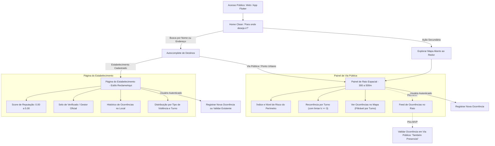
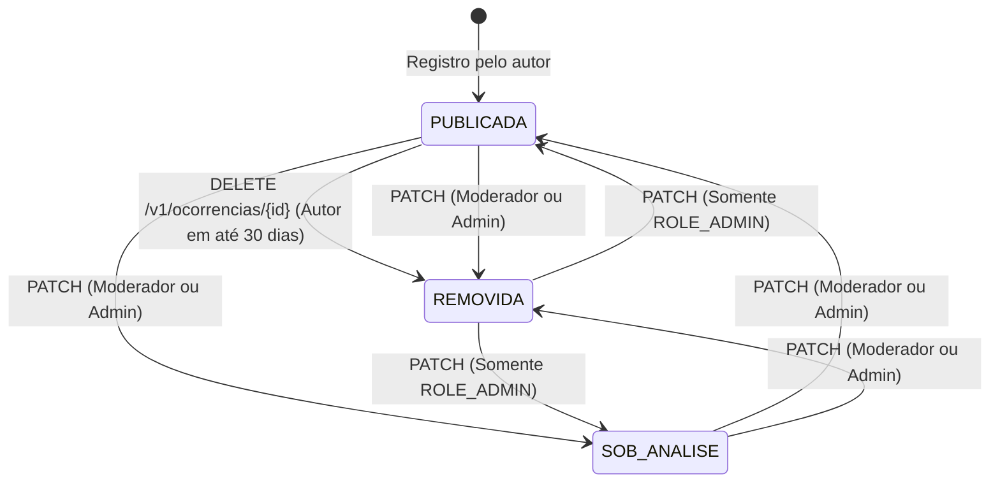

# Lume — Especificação Funcional e Regras de Negócio por Módulo

> **Status:** Especificação Consolidada (MVP Didático — Alinhada à branch `develop`)  
> **Finalidade:** Disciplinas de Desenvolvimento Web/Multiplataforma, Segurança de Aplicações e Projeto de TCC.

> **Navegação:** [← Voltar ao README](../README.md) · [Modelagem de Dados PostgreSQL](modelagem-dados.md) · [Contrato OpenAPI 3.0.3](../src/main/resources/api/openapi.yaml)

---

## 1. Visão Geral e Proposta de Valor

O **Lume** é uma plataforma colaborativa voltada à **segurança comunitária, preventiva e territorial**, cujo foco central é empoderar pessoas — com ênfase especial em grupos historicamente vulnerabilizados (**mulheres, pessoas negras e comunidade LGBTQIA+**) — por meio de informações transparentes, contextuais e anonimizadas sobre a segurança de locais, estabelecimentos e áreas urbanas.

Diferente de mapas de calor criminais genéricos, o Lume opera no modelo **"Search-First" (Orientado ao Destino)** e no padrão **"ReclameAqui da Segurança e Cidadania"**:
* Responde prioritariamente à pergunta: *"Para onde você deseja ir?"*.
* Permite buscar por **Estabelecimentos Específicos** (bares, casas noturnas, restaurantes, faculdades, shoppings) para avaliar sua reputação (`0.00` a `5.00`), histórico de incidentes e ocorrências.
* Permite buscar por **Vias Públicas** (ruas, avenidas, praças, terminais) para obter diagnóstico de risco por perímetro e visualizar ocorrências recentes no mapa.
* **Delimitação de Escopo:** **Residências particulares estão estritamente fora de escopo**, eliminando riscos de estigmatização de moradias ou invasão de privacidade domiciliar.

---

## 2. Fluxo Principal da Aplicação (UX Search-First)

---

## 3. Regras de Negócio Detalhadas por Módulo

### 3.1. Núcleo Transversal, Segurança e Governança (`shared`)

#### RN01 — Acesso Público para Visualização
* A consulta de catálogos, busca/detalhe de estabelecimentos, histórico de ocorrências de estabelecimentos, diagnóstico de risco por raio, pontos do mapa e detalhe de ocorrência publicada são **públicos** (`permitAll()`).
* Todas as leituras públicas obedecem às regras de supressão e anonimização definidas na **RN04**.

#### RN02 — Autenticação Obrigatória para Escrita e Dados Pessoais
* O registro de estabelecimentos, registro/exclusão/validação de ocorrências, moderação, consulta de perfil próprio (`/v1/usuarios/me`), listagem de ocorrências próprias (`/v1/ocorrencias/minhas`) e painel do gestor (`/v1/estabelecimentos/meu`) exigem **token JWT Bearer válido** (`type = "access"`).

#### RN12 — Perfis e Hierarquia de Acesso (RBAC)
* A aplicação define quatro papéis persistidos na tabela `perfis` e gerenciados via `SecurityConfig` (`@EnableMethodSecurity`):
  * **`ROLE_USUARIO`**: papel padrão atribuído no cadastro; permite registrar ocorrências, validar ocorrências de terceiros e excluir logicamente os próprios relatos dentro do prazo.
  * **`ROLE_GESTOR`**: gestor oficial de estabelecimento comercial; habilita consulta ao vínculo ativo (`/v1/estabelecimentos/meu`) e atualização cadastral/status operacional (`/v1/estabelecimentos/{id}`).
  * **`ROLE_MODERADOR`**: moderação comunitária de ocorrências via `PATCH /v1/ocorrencias/{id}` (com restrição sobre registros já removidos — ver **RN15**).
  * **`ROLE_ADMIN`**: administração completa da plataforma, incluindo qualquer transição de status de moderação.
* **Hierarquia configurada (`RoleHierarchyImpl`):** `ROLE_ADMIN > ROLE_MODERADOR > ROLE_USUARIO`. O papel `ROLE_GESTOR` é ortogonal e verificado explicitamente em conjunto com o vínculo ativo na tabela `estabelecimentos_gestores`.

#### Governança Temporal, JWT, Criptografia e Resiliência
* **Fuso de Negócio:** `lume.zona-negocio` fixado em `America/Sao_Paulo` para derivação de datas locais (`dataRegistro`, validação de `dataOcorrencia` futura e janelas retroativas).
* **Travas de Startup (`@Validated`):**
  * `JwtProperties`: exige `jwt.secret` com mínimo de **32 bytes (256 bits)** e limita `jwt.expiration` a no máximo **`900.000 ms` (15 minutos)**; `jwt.refresh-expiration` e `jwt.issuer` são obrigatórios.
  * `CryptoProperties`: exige `lume.security.crypto.cpf-hmac-key` com mínimo de **32 bytes** e `lume.security.crypto.cpf-aes-key` com **exatamente 32 bytes (256 bits)**.
* **Rastreabilidade & Erros Canônicos:** `RequestIdFilter` valida/gera `X-Request-Id` (padrão `^[A-Za-z0-9-]{1,64}$`), injeta no MDC e devolve no header HTTP; exceções de validação, segurança e negócio são convertidas pelo `GlobalExceptionHandler` em `StandardError`.
* **Outbox Transacional e Lock Distribuído:** eventos de domínio publicados pelo módulo `ocorrencia` são gravados na tabela `event_publication` na mesma transação do banco e reprocessados caso fiquem incompletos pelo job agendado `ResubmitIncompleteEventsJob` (intervalo padrão `60s`, idade mínima `1 min`), protegido por **ShedLock** (`lockAtMostFor = PT5M`, `lockAtLeastFor = PT30S`).

---

### 3.2. Módulo: Identidade e Acesso (`identidade`)

#### RN03 — Unicidade de Cadastro, Criptografia de CPF e Normalização
* **Validação de CPF:** validado algoritmicamente (`CpfValidator`: 11 dígitos numéricos, rejeição de sequências repetidas e verificação dos dois dígitos verificadores). O CPF nunca transita em logs ou respostas públicas de terceiros.
* **Blind Index (`cpf_hash`):** gerado via **HMAC-SHA256** utilizando `lume.security.crypto.cpf-hmac-key` e armazenado em coluna `UNIQUE NOT NULL` (`VARCHAR(64)`), garantindo unicidade sem armazenar texto plano nem permitir ataques de dicionário sem a chave secreta.
* **Cifração Reversível (`cpf_cifrado`):** cifrado via `CpfCryptoConverter` / `CpfCryptoService` com **AES-256-GCM** (`NoPadding`, tag de 128 bits) e **IV aleatório de 12 bytes por operação**, codificado em Base64 (`IV || ciphertext`). Destina-se exclusivamente à consulta do próprio titular (`GET /v1/usuarios/me`) e eventual responsabilização legal mediante requisição judicial fundamentada.
* **Normalização e Unicidade de Contato:**
  * `telefone`: higienizado para conter apenas `10` ou `11` dígitos numéricos (`^[0-9]{10,11}$`) com restrição `UNIQUE`.
  * `email`: normalizado com `trim()` e `toLowerCase(Locale.ROOT)` com unicidade *case-insensitive*.
* **Privacidade na Resposta de Conflito (`HTTP 409`):** ao detectar colisão de `cpf_hash`, `telefone` ou `email` no cadastro (`POST /v1/auth/cadastrar`), a API retorna mensagem genérica (`"Não foi possível concluir o cadastro com os dados informados."`), evitando enumeração de contas por terceiros.
* **Dados Demográficos Opcionais:** `genero`, `racaEtnia` e `orientacaoSexual` são opcionais e assumem `PREFIRO_NAO_INFORMAR` por padrão.
* **Política de Senha:** mínimo de `8` e máximo de `64` caracteres, armazenada com hash **BCrypt** (`BCryptPasswordEncoder`).

#### Política de Autenticação, Lockout Anti-Força Bruta e Refresh Token
* **Lock Pessimista e Mitigação de *Timing Attack*:**
  * A busca de credencial no login (`POST /v1/auth/login`) utiliza `LockModeType.PESSIMISTIC_WRITE` para serializar tentativas simultâneas contra a mesma conta.
  * Quando o e-mail não existe, o serviço executa verificação simulada com `BCrypt` sobre `DUMMY_PASSWORD_HASH` antes de lançar `HTTP 401`, equiparando o tempo de resposta e dificultando enumeração de e-mails.
* **Regra Progressiva de *Account Lockout* (`LockoutProperties`):**
  * **Limite inicial (`max-tentativas`):** `5` falhas consecutivas.
  * **Tempo de bloqueio (`minutos-bloqueio`):** `15` minutos (`HTTP 423 Locked`).
  * **Tentativas após expiração (`tentativas-apos-desbloqueio`):** `3` tentativas — quando o prazo de bloqueio expira e ocorre nova falha, `tentativasFalhas` é ajustado para `maxTentativas - tentativasAposDesbloqueio` (`5 - 3 = 2`), reduzindo a margem antes de novo bloqueio.
  * **Login bem-sucedido:** zera `tentativasFalhas`, limpa `bloqueadoAte` e atualiza `ultimoLoginEm`.
* **Conta Ativa e Renovação (`POST /v1/auth/refresh`):** exige conta com `ativo = true` e não bloqueada tanto na emissão inicial quanto na renovação do token. Tokens de *refresh* possuem claim `type = "refresh"` e são explicitamente rejeitados pelo `JwtDecoder` nas rotas protegidas da API (que exigem `type = "access"`).

#### Gestão do Perfil Próprio (`/v1/usuarios/me`)
* O usuário autenticado consulta seus dados cadastrais (incluindo `cpf` decifrado) e pode atualizar `nomeCompleto`, `telefone` (com validação de unicidade exceto o próprio ID) e campos demográficos. Alteração de CPF e papéis não é permitida por esta rota.

---

### 3.3. Módulo: Catálogos de Domínio (`catalogo`)

#### RN08 — Formulário Fechado sem Texto Livre
* Todo relato é classificado exclusivamente a partir dos catálogos oficiais mantidos pelo módulo `catalogo`, eliminando campos abertos de descrição narrativa e mitigando riscos de calúnia nominal, difamação, exposição de dados pessoais de terceiros (*doxxing*) ou discurso de ódio.

#### RN09 — Taxonomia de Tipos de Violência e Ponderação (1 a 10)
Os tipos de violência ativos possuem `peso_gravidade` de `1` a `10`, utilizado diretamente pelo motor de cálculo de reputação e risco (**RN14**):

| Faixa de Gravidade | Tipos Seedados no Banco (`V1`) | Peso |
| :--- | :--- | :---: |
| **Baixa (1–3)** | `ASSEDIO_VERBAL` (Assédio Verbal / Importunação) | `2` |
| | `OUTRO` (Outro Tipo de Violência) | `3` |
| **Média (4–6)** | `AGRESSAO_VERBAL_AMEACA` (Ameaça e Intimidação Verbal) | `4` |
| | `PERSEGUICAO_STALKING` (Perseguição / *Stalking*) | `5` |
| | `DISCRIMINACAO` (Discriminação / Preconceito) | `5` |
| | `IMPORTUNACAO_SEXUAL` (Importunação Sexual) | `6` |
| | `ROUBO_FURTO` (Roubo / Furto) | `6` |
| **Alta (7–9)** | `AGRESSAO_FISICA` (Agressão Física) | `8` |
| **Máxima / Hediondos (10)** | `ESTUPRO_VIOLENCIA_SEXUAL` (Estupro / Violência Sexual) | `10` |
| | `LATROCINIO` (Latrocínio) | `10` |
| | `HOMICIDIO_OU_TENTATIVA` (Homicídio ou Tentativa) | `10` |

#### RN10 — Marcadores de Vulnerabilidade Opcionais
* A associação de um marcador motivacional (`MISOGINIA`, `RACISMO`, `LGBTFOBIA`, `CAPACITISMO`, `INTOLERANCIA_RELIGIOSA`) é **opcional**, permitindo registrar ocorrências sem atribuir motivação preconceituosa quando não identificável.

#### RN11 — Acolhimento em Crimes Hediondos (Diretriz de Produto / Cliente)
* Ao selecionar violência sexual/estupro na aplicação cliente (Web/Flutter), a interface deve exibir imediatamente orientações de profilaxia médica emergencial (PEP em até 72h) e atalhos para canais oficiais de socorro (`180`, `190`, `197`).

#### Cache de Catálogos
* Todas as consultas de listagem ativa e buscas por ID usam cache local **Caffeine** (`maximumSize = 500`, `expireAfterWrite = 1h`), além de emitir `Cache-Control: max-age=3600, public, stale-while-revalidate=600` nas respostas REST de `/v1/catalogos/**`.
* Apenas itens com `ativo = true` são aceitos em novos cadastros de estabelecimentos ou registros de ocorrências.

---

### 3.4. Módulo: Estabelecimentos e Reputação (`estabelecimento`)

#### Cadastro, CNPJ Alfanumérico e Endereço Canônico
* **Dados Obrigatórios no Cadastro (`POST /v1/estabelecimentos`):** `nome` (`3–150` caracteres), `categoriaId` (ativa no módulo `catalogo`), endereço segmentado (`logradouro`, `numero` opcional, `bairro`, `cidade`, `estado` UF com 2 letras maiúsculas) e coordenadas geográficas válidas (`latitude` `[-90, 90]`, `longitude` `[-180, 180]`), convertidas para `GEOGRAPHY(Point, 4326)` via `GeoUtils`.
* **CNPJ Opcional e Alfanumérico (`CnpjValidator`):** quando informado, é normalizado para maiúsculas e validado contra o padrão alfanumérico de 14 caracteres (`^[0-9A-Za-z]{12}[0-9]{2}$`) com verificação algorítmica dos 2 dígitos verificadores e restrição de unicidade (`HTTP 409`).
* **Estado Inicial:** todo estabelecimento inicia com `score_reputacao = 5.00`, `verificado = false` e `ativo = true`.

#### Busca *Search-First* e Proximidade Espacial
* **Autocomplete (`GET /v1/estabelecimentos/autocomplete`):** exige `termo` com no mínimo `2` caracteres, filtro opcional por `cidade` e `limite` entre `1` e `20` (padrão `5`). Retorna apenas estabelecimentos `ativo = true`, ordenados por `verificado DESC, scoreReputacao DESC, nome ASC`.
* **Listagem Paginada (`GET /v1/estabelecimentos`):** suporta `termo` (nome ou logradouro), `categoriaId`, `cidade`, `bairro`, `page` (padrão `0`), `size` (`1–100`, padrão `20`) e busca espacial opcional (`latitude` + `longitude` devem ser informadas em conjunto).
  * Quando coordenadas são fornecidas, valida `raioMetros` entre **`100 m` e `5.000 m`** (padrão `1.000 m` via `GeoProperties`), aplica `ST_DWithin` e ordena por **menor distância geodésica (`ST_Distance`)** seguida de `score_reputacao DESC`.

#### Gestão Oficial por `ROLE_GESTOR`
* **Vínculo Automático no Cadastro:** caso o usuário autenticado que criou o estabelecimento possua `ROLE_GESTOR`, o sistema cria automaticamente um registro ativo em `estabelecimentos_gestores` com `cargo = "GESTOR_RESPONSAVEL"`.
* **Consulta do Estabelecimento Gerenciado (`GET /v1/estabelecimentos/meu`):** exige `ROLE_GESTOR` (`HTTP 403` se ausente) e retorna o vínculo ativo mais recente (`204 No Content` se o gestor não estiver vinculado a nenhum estabelecimento ativo).
* **Atualização Cadastral (`PUT /v1/estabelecimentos/{id}`):** exige cumulativamente `ROLE_GESTOR` **e** vínculo ativo específico com o estabelecimento alvo em `estabelecimentos_gestores` (`HTTP 403` caso contrário). Permite atualizar dados cadastrais, CNPJ (checando unicidade `existsByCnpjAndIdNot`) e flag `ativo`.

#### Perfil Detalhado e Atualização Reativa de Reputação
* `GET /v1/estabelecimentos/{id}` consulta o módulo `ocorrencia` via `OcorrenciaEstabelecimentoQueryPort` para compor `totalOcorrenciasHistoricas`, `distribuicaoTurno` e `distribuicaoTipoViolencia` (considerando apenas ocorrências `PUBLICADA`).
* O `score_reputacao` persistido é recalculado assincronamente pelo `ReputacaoEstabelecimentoEventListener` (com `LockModeType.PESSIMISTIC_WRITE` via `findByIdWithLock`) ao receber `ReputacaoEstabelecimentoRecalculadaEvent`, evitando contenção de escrita na transação de origem e garantindo consistência eventual pelo Outbox.

---

### 3.5. Módulo: Ocorrências e Segurança Territorial (`ocorrencia`)

#### RN05 & RN06 — Escopo Territorial e Endereço Canônico Segmentado
* A plataforma restringe relatos exclusivamente a:
  1. **Estabelecimentos** comerciais, culturais, esportivos, educacionais e de saúde (`estabelecimentoId != null`).
  2. **Espaços públicos urbanos:** `VIA_PUBLICA`, `TRANSPORTE_PUBLICO`, `PARQUE_PRACA` e `OUTRO` (`estabelecimentoId == null`).
* **Dualidade no Registro (`POST /v1/ocorrencias`):**
  * **Com `estabelecimentoId`:** o estabelecimento deve existir e estar ativo (`HTTP 404` caso contrário); o `tipoAmbiente` (se informado) deve ser `ESTABELECIMENTO`; as coordenadas e o endereço (`logradouro`, `numero`, `bairro`, `cidade`, `estado`) são herdados automaticamente do cadastro oficial do estabelecimento, impedindo adulteração espacial.
  * **Sem `estabelecimentoId` (via pública / espaço urbano):** exige `latitude`, `longitude`, endereço segmentado obrigatório e `tipoAmbiente` válido diferente de `ESTABELECIMENTO`.
* **Eliminação de Campo Livre:** não existe campo `referencia_adicional` nem texto narrativo livre.

#### RN07 — Janela Temporal em Turnos e Data Válida
* O horário exato não é coletado nem exposto; usa-se exclusivamente o enum `FaixaHorario`:
  * `MADRUGADA` (00h00 às 05h59)
  * `MANHA` (06h00 às 11h59)
  * `TARDE` (12h00 às 17h59)
  * `NOITE` (18h00 às 23h59)
* A `dataOcorrencia` não pode ser posterior à data corrente no fuso `America/Sao_Paulo`.

#### RN04 — Anonimização Estrita do Relator, Geo-Privacidade e *k-Anonymity*
* **Omissão do Autor:** o campo `criado_por` existe apenas para auditoria interna, validação de autoria na exclusão e bloqueio de autovalidação; nunca é exposto em endpoints públicos ou listagens de terceiros.
* **Atenuação para Vias Públicas (`estabelecimentoId == null`):**
  * **Espacial:** em `GET /v1/seguranca/ocorrencias-mapa` e `GET /v1/ocorrencias/{id}`, `latitude` e `longitude` são arredondadas para **3 casas decimais (`RoundingMode.HALF_UP`, precisão aproximada de ~110 metros)** via `GeoUtils.arredondarParaAnonimizacao`.
  * **Identificador e Endereço:** nos pontos do mapa, o campo `id` da ocorrência é omitido; no detalhe (`GET /v1/ocorrencias/{id}`), os campos específicos `logradouro`, `numero` e `bairro` são suprimidos (`null`), preservando apenas `cidade` e `estado`.
  * **Temporal:** respostas públicas expõem apenas datas (`YYYY-MM-DD`) no fuso `America/Sao_Paulo` (sem timestamps com hora/minuto/segundo). Para vias públicas, tanto `dataOcorrencia` quanto `dataRegistro` são truncadas para o **1º dia do mês** (`withDayOfMonth(1)`).
* **Proteção contra Ataques de Diferenciação no Diagnóstico Territorial (`GET /v1/seguranca/diagnostico-raio`):**
  * Janela fixa de análise: últimos **`365` dias** a partir da data corrente em `America/Sao_Paulo`, considerando apenas ocorrências `PUBLICADA` dentro do raio (`300 m` a `500 m`, padrão `500 m`).
  * `totalOcorrencias` é mantido exato para não ocultar alertas em locais com 1 ou 2 relatos (ver risco residual aceito na **Seção 5**).
  * **Discretização do Score de Risco:** `scoreRisco` é arredondado em degraus de **`0.50`** (`HALF_UP`) antes de ser retornado e usado na classificação de `nivelRisco`.
  * **Limiar $k \ge 3$ (`LIMIAR_K_ANONIMIZACAO = 3`):**
    * `distribuicaoTurno`: se `totalOcorrencias < 3`, todos os turnos retornam `0`; quando `>= 3`, qualquer turno individual com contagem `< 3` é suprimido para `0`.
    * `distribuicaoViolencia` e `distribuicaoMarcadores`: categorias com contagem `< 3` são omitidas da listagem nominal e acumuladas em um item sintético `OUTROS` (`id = 0`), que só é incluído na resposta caso a soma acumulada atinja `>= 3`.
* **Escopo do Mapa Público (`GET /v1/seguranca/ocorrencias-mapa`):**
  * Parâmetros configurados via `GeoProperties`: `raioMetros` entre `100` e `1000` (padrão `500`), janela retroativa `dias` entre `1` e `365` (padrão `90`) e teto de `500` pontos retornados (`limiteMaximoPontos`).
  * Filtros opcionais: `tipoViolenciaId`, `marcadorId` e `faixaHorario`.
  * No MVP, não aplica supressão $k$ por célula de ~110 m (ver **Seção 5**).

#### RN13 — Validação Comunitária e Limites Anti-Abuso (Anti-Sybil)
* **Limite Diário de Registros:** um usuário autenticado pode registrar no máximo **5 ocorrências em uma janela móvel de 24 horas** (`LIMITE_OCORRENCIAS_24H = 5`, `HTTP 422` se excedido). Para impedir *race condition* por requisições concorrentes, `OcorrenciaService.registrarOcorrencia` adquire lock pessimista (`PESSIMISTIC_WRITE`) na linha do usuário via `IdentidadeInternalFacade.adquirirLockParaUsuario(usuarioId)` antes de contabilizar.
* **Regras de Validação Comunitária (`POST /v1/ocorrencias/{id}/validacoes`):**
  * Apenas ocorrências com status `PUBLICADA` podem ser validadas (`HTTP 404` se inexistente/não publicada).
  * **Janela de 30 dias:** só é permitida em até `30` dias a partir de `criado_em` (`HTTP 422` se expirado).
  * **Anti-Autovalidação:** o autor original (`criado_por`) não pode validar o próprio relato (`HTTP 409 Conflict`).
  * **Unicidade (Anti-Sybil):** restrição `UNIQUE(ocorrencia_id, usuario_id)` (`HTTP 409` se já houver validação ativa). Caso o usuário tenha cancelado anteriormente sua validação (`DELETE /v1/ocorrencias/{id}/validacoes`), pode reativá-la dentro dos 30 dias com o novo `tipoValidacao` (`PRESENCIEI` ou `CONHECO_RISCO`).
  * **Consistência e Evento:** `total_validacoes` é incrementado/decrementado atomicamente no banco via `@Modifying` query e dispara `ReputacaoEstabelecimentoRecalculadaEvent` quando houver `estabelecimentoId`.
* **Descoberta de `id` para Engajamento no MVP:** o usuário autenticado descobre o `id` de ocorrências de terceiros para validação via histórico do estabelecimento (`GET /v1/estabelecimentos/{id}/ocorrencias`) ou UUID direto (`GET /v1/ocorrencias/{id}`). A descoberta via feed em vias públicas é evolução pós-MVP (**Seção 6**).

#### RN14 — Algoritmo de Impacto, Reputação e Risco Territorial
1. **Fator de Decaimento Temporal (`calcularFatorDecaimentoTemporal`):** considerando `dias = max(0, diasEntre(dataOcorrencia, hoje))`:
   * `dias <= 30`: **`1.0`** (`lume.reputacao.fator-dias-30`)
   * `31 <= dias <= 90`: **`0.6`** (`lume.reputacao.fator-dias-90`)
   * `91 <= dias <= 365`: **`0.2`** (`lume.reputacao.fator-dias-365`)
   * `dias > 365`: **`0.05`** (`lume.reputacao.fator-residual`)

2. **Impacto Individual da Ocorrência (`calcularImpactoOcorrencia`):** com teto de **`10`** validações computadas (multiplicador máximo de `3.0`):
   $$\text{Impacto} = \text{Peso}_{\text{gravidade}} \times \text{Fator}_{\text{tempo}} \times \left(1 + \min(\text{Validações},\; 10) \times 0{,}2\right)$$

3. **Score de Reputação do Estabelecimento (`0.00` a `5.00`):** sobre todas as ocorrências `PUBLICADA` vinculadas ao estabelecimento:
   $$\text{Score}_{\text{estabelecimento}} = \max\left(0{,}00,\;\; 5{,}00 - \left(\sum \text{Impacto} \times 0{,}10\right)\right)$$
   *(Sem ocorrências publicadas, o score retorna `5.00`.)*

4. **Score e Nível de Risco em Via Pública / Raio (`0.00` a `10.00`):** sobre ocorrências `PUBLICADA` nos últimos 365 dias no raio:
   $$\text{Score}_{\text{risco\_exato}} = \min\left(10{,}00,\;\; \left(\sum \text{Impacto}\right) \times 0{,}20\right)$$
   Após discretização em degraus de `0.50` (`HALF_UP`), o nível de risco é classificado por:
   * **`BAIXO`**: `scoreRisco < 2.50`
   * **`MEDIO`**: `2.50 <= scoreRisco < 5.00`
   * **`ALTO`**: `5.00 <= scoreRisco < 7.50`
   * **`CRITICO`**: `scoreRisco >= 7.50`

#### RN15 — Ciclo de Vida, Exclusão Lógica e Moderação (`StatusOcorrencia`)

* **Exclusão Lógica pelo Autor (`DELETE /v1/ocorrencias/{id}`):**
  * Exige ser o autor original (`criado_por == usuarioAutenticado` — senão `HTTP 403`).
  * Exige status atual `PUBLICADA` e criação há no máximo **30 dias** (`HTTP 422` se expirado ou já removida).
  * A listagem pessoal (`GET /v1/ocorrencias/minhas`) retorna `permiteExclusao` já calculado para orientar a interface.
* **Alçada de Moderação (`PATCH /v1/ocorrencias/{id}`):**
  * `ROLE_MODERADOR`: pode alternar entre `PUBLICADA` e `SOB_ANALISE`, ou mover para `REMOVIDA`. **É estritamente proibido** de alterar qualquer ocorrência que já esteja no status `REMOVIDA` (`HTTP 403 Forbidden`).
  * `ROLE_ADMIN`: possui alçada total sobre qualquer transição entre `PUBLICADA`, `SOB_ANALISE` e `REMOVIDA`.
* Qualquer exclusão ou alteração de status de ocorrência vinculada a estabelecimento dispara `ReputacaoEstabelecimentoRecalculadaEvent` para atualizar a nota do local.

---

## 4. Requisitos do Sistema (Resumo de Rastreabilidade)

### 4.1. Requisitos Funcionais (RF)
* **RF01:** Buscar estabelecimentos por nome comercial ou logradouro com autocomplete rápido (`GET /v1/estabelecimentos/autocomplete`) e listagem filtrada/espacial (`GET /v1/estabelecimentos`).
* **RF02:** Exibir página de reputação de estabelecimento com score (`0.00` a `5.00`), selo verificado e distribuições por turno e tipo de violência (`GET /v1/estabelecimentos/{id}`).
* **RF03:** Exibir diagnóstico de segurança territorial em raio espacial (`GET /v1/seguranca/diagnostico-raio`).
* **RF04:** Consultar e filtrar pontos de ocorrências no mapa por janela de dias, tipo de violência, marcador de vulnerabilidade e faixa de horário (`GET /v1/seguranca/ocorrencias-mapa`).
* **RF05:** Cadastrar usuários com CPF (cifrado + *blind index*), telefone normalizado e dados demográficos opcionais (`POST /v1/auth/cadastrar`).
* **RF06:** Autenticar com proteção contra força bruta (`POST /v1/auth/login`) e renovar sessão via *refresh token* (`POST /v1/auth/refresh`).
* **RF07:** Registrar ocorrências estruturadas vinculadas a estabelecimentos ou espaços públicos urbanos (`POST /v1/ocorrencias`), consultar histórico próprio (`GET /v1/ocorrencias/minhas`) e excluir logicamente em até 30 dias (`DELETE /v1/ocorrencias/{id}`).
* **RF08:** Registrar e cancelar validação comunitária de relatos publicados (`POST`/`DELETE /v1/ocorrencias/{id}/validacoes`) com recálculo assíncrono de reputação.
* **RF09:** Gerenciar estabelecimento vinculado por usuário com perfil `ROLE_GESTOR` (`GET /v1/estabelecimentos/meu`, `PUT /v1/estabelecimentos/{id}`).
* **RF10:** Apresentar orientações de acolhimento e canais de emergência (180, 190, 197) na interface cliente em relatos de crimes hediondos.
* **RF11:** Moderar status de ocorrências (`PATCH /v1/ocorrencias/{id}`) com controle de alçada entre `ROLE_MODERADOR` e `ROLE_ADMIN`.

### 4.2. Requisitos Não Funcionais (RNF)
* **RNF01 (Segurança & LGPD):** hashing de senhas com `BCryptPasswordEncoder`; tokens JWT stateless com *access token* de no máximo `15 minutos` (`900.000 ms`) e *refresh token* configurável (`7 dias` nos perfis `local`/`test`); validação estrita de chaves no startup (`jwt.secret >= 32 bytes`, `cpf-hmac-key >= 32 bytes`, `cpf-aes-key == 32 bytes`).
* **RNF02 (Desempenho Geoespacial):** consultas espaciais por raio com PostGIS utilizando tipo `GEOGRAPHY(Point, 4326)` e índices `GIST`.
* **RNF03 (Contrato & Multiplataforma):** especificação *Contract-First* OpenAPI 3.0.3 para integração consistente com clientes Web e Flutter (Android/iOS/Web).
* **RNF04 (Arquitetura Modular & Qualidade):** isolamento estrito via Spring Modulith (`catalogo`, `identidade`, `estabelecimento`, `ocorrencia`, `shared`), `open-in-view: false`, Virtual Threads Java 25 e validação automatizada de fronteiras e cadeia de segurança.

---

## 5. Riscos Residuais Aceitos (MVP) e Pré-requisitos de Produção

Para manter a utilidade preventiva da plataforma em cenários iniciais de baixa densidade de relatos no MVP didático, as decisões abaixo foram aceitas com seus respectivos controles compensatórios obrigatórios para produção pública:

1. **Inferência Espacial via `totalOcorrencias` Exato (`GET /v1/seguranca/diagnostico-raio`):**
   * **Decisão de Produto (MVP):** `totalOcorrencias` permanece exato para garantir transparência de alertas preventivos em locais com 1 ou 2 relatos (enquanto as distribuições aplicam $k \ge 3$ e `scoreRisco` é discretizado em degraus de `0.50`).
   * **Risco:** como a contagem muda quando um ponto entra ou sai do perímetro consultado, dezenas de consultas deslocando o centro em pequenos passos podem inferir localização com precisão superior à célula de ~110 m já exposta no mapa.
   * **Mitigação Obrigatória em Produção:** implantar **WAF ou API Gateway com *rate limiting*** e detecção de varreduras automatizadas na borda sobre `GET /v1/seguranca/diagnostico-raio`.
   * **Alternativa Evolutiva Pós-MVP:** agrupar `totalOcorrencias` em faixas (`1–2`, `3–5`, `6+`).
2. **Mapa Público sem Limiar $k$ por Célula de ~110 m (`GET /v1/seguranca/ocorrencias-mapa`):**
   * Optou-se no MVP por não suprimir células com menos de $k$ ocorrências para não ocultar alertas em regiões de baixa densidade. A privacidade apoia-se em arredondamento espacial de 3 casas (`HALF_UP`), omissão do `id`, supressão de endereço específico no detalhe e truncamento mensal das datas.
3. **Pré-requisitos Operacionais de Implantação:**
   * **Schema Flyway (`V1` consolidada):** em bancos que tenham aplicado versões antigas antes da consolidação, é necessária recriação limpa do schema antes do boot da API contra PostgreSQL 16+ / PostGIS real.
   * **Isolamento de Perfis:** `application-local.yaml` deve ser usado exclusivamente em desenvolvimento local; implantação em nuvem exige perfil padrão/`prod` com segredos injetados via variáveis de ambiente.

---

## 6. Evoluções Futuras Planejadas (Pós-MVP)

1. **Feed Territorial e Engajamento Comunitário em Vias Públicas:**
   * **Contexto no MVP:** a descoberta de ocorrências com `id` para validação comunitária (`POST`/`DELETE /v1/ocorrencias/{id}/validacoes`) ocorre no fluxo de estabelecimentos (`GET /v1/estabelecimentos/{id}/ocorrencias`) ou via UUID direto em `GET /v1/ocorrencias/{id}`. Em vias públicas, `GET /v1/seguranca/ocorrencias-mapa` omite propositalmente o `id` (**RN04**).
   * **Evolução Planejada:** introduzir endpoint paginado de **Feed de Ocorrências no Raio** (ex.: `GET /v1/seguranca/ocorrencias-raio`) retornando `id` e indicador `permiteValidacao` (janela de 30 dias) para permitir validação comunitária também em vias públicas, preservando integralmente as atenuações da **RN04** (omissão de `logradouro`/`numero`/`bairro`, coordenadas com 3 casas decimais e datas truncadas no dia 1 do mês).
2. **Rate Limiting e Observabilidade Avançada:** adição de Spring Boot Actuator / métricas Prometheus e políticas de *rate limiting* por IP/usuário em API Gateway ou filtro dedicado.
3. **Testes de Integração com Banco Real:** ampliação da suíte com **Testcontainers** (`postgis/postgis`) para validação automatizada de queries PostGIS e execução do Flyway em CI/CD.
